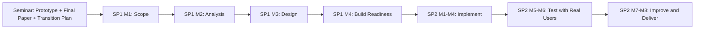

# แผน Transition จาก Seminar ไป SP1 / SP2

**โครงการ:** ระบบบริหารจัดการทุนวิจัยส่วนตัว มหาวิทยาลัยแม่ฟ้าหลวง  
**ทีม:** 404 Team Found  
**ฉบับ:** 1.1 — 16 พฤศจิกายน 2569  
**สถานะ:** แผนเสนอเพื่อยืนยันกับอาจารย์และ Stakeholder

## 1. เป้าหมายและขอบเขตการเปลี่ยนผ่าน

Seminar ปัจจุบันเป็นต้นแบบ RS-1 ที่มีการกรอก/อัปโหลด DOCX, สกัดข้อมูลแบบ rule-based, ตรวจแก้ และสร้างเอกสาร โดยเก็บร่างใน browser เป็นหลัก. แผนนี้วางภาพรวมทั้งโครงการตาม SDLC เพื่อให้ GitHub แสดงว่า “ทำอะไร ส่งมอบอะไร เมื่อไร และใครรับผิดชอบ” ตั้งแต่ Seminar ถึง Senior Project 2 ไม่ใช่เพียงรายการงานของ sprint ถัดไป

- **Seminar:** วิเคราะห์ Requirement, ออกแบบ workflow/data/architecture, สร้างและประเมิน prototype RS-1, จัดทำ IEEE Final Paper และ Transition Plan
- **Senior Project 1 (SP1):** ทำรายละเอียด analysis/design ให้พร้อมสร้างจริง: Product backlog, data model, API/security design, UX prototype, test plan, deployment plan และ risk/decision log
- **Senior Project 2 (SP2):** สร้างระบบจริง 4 เดือน → ทดสอบกับผู้ใช้จริง 2 เดือน → ปรับปรุงและทดสอบซ้ำ 2 เดือน ตามแนวทางที่อาจารย์ระบุ
- งานนอกขอบเขตจนกว่าจะได้รับอนุมัติ: เชื่อม e-Office โดยตรง, OCR/ไฟล์สแกน, การส่งอีเมลจริง, การตัดสินมาตรฐานวิจัยอัตโนมัติ, และการลบข้อมูลถาวร

ข้อกำหนด, Transition และเรื่องเปิดต้องยึด [requirement.md](../02-requirements/requirement.md), [State Transition Diagram.md](../02-requirements/State%20Transition%20Diagram.md) และ [Traceability.md](../02-requirements/Traceability.md) เป็นแหล่งอ้างอิงเดียว

## 2. หลักการตัดสินใจ

1. **ไม่ย้ายข้อมูลจริงโดยไม่มีเจ้าของข้อมูลอนุมัติ** — รอบ pilot ใช้ข้อมูลสังเคราะห์หรือเอกสารจริงที่ลบข้อมูลระบุตัวตนแล้ว
2. **ไม่ปิด OPEN ด้วยการเดา** — รายการที่ต้องใช้นโยบายจาก Stakeholder มีเจ้าของ, วันที่ตัดสินใจ และผลกระทบชัดเจน
3. **ทดลองเป็นขั้น (feature flag / pilot workspace)** — ผ่านเกณฑ์แต่ละ Gate ก่อนขยายผู้ใช้หรือเปิด workflow ถัดไป
4. **บันทึกหลักฐาน** — ทุก defect, ผล usability test, การอนุมัติ และการเปลี่ยน requirement ต้องเชื่อม Requirement/AC/UC ที่เกี่ยวข้อง
5. **รักษาข้อดีของ Seminar** — การสกัดยังเป็น local deterministic; ผู้ใช้ตรวจแก้ก่อนยืนยันข้อมูล; ไม่ส่งไฟล์ไปบริการ AI/OCR ภายนอก

## 3. แผนเวลาโครงการ (Roadmap)

> วันส่ง Final Document/Final Presentation และปฏิทินรายวิชาต้องยืนยันใน Google Classroom. บันทึกการประชุมระบุให้ส่ง **วันพุธสัปดาห์ถัดไป**; แผนจึงใช้ชื่อช่วงเวลาแทนวันที่ตายตัว และต้องใส่วันจริงทันทีหลังตรวจประกาศรายวิชา

| ช่วง | ระยะโดยประมาณ | งานหลัก | ผลส่งมอบ / Gate |
| --- | --- | --- | --- |
| Seminar Final | ก่อนกำหนดส่งรายวิชา | ปิด Requirement, Use Case, Workflow, Prototype evidence, transition plan และ IEEE paper | อาจารย์เห็นภาพปัญหา/solution/tech stack/แผนพัฒนาต่อ; GitHub เป็น baseline ปัจจุบัน |
| SP1 เดือน 1 | Discover & scope | ยืนยัน stakeholder goals, P0/P1/P2, user roles, data classification, OPEN decision log และ acceptance criteria | Signed-off SP1 scope; change-control workflow |
| SP1 เดือน 2 | Analysis | process map, use cases, data dictionary, state/permission matrix, non-functional/security requirements | Requirements baseline และ traceability Requirement → AC → test |
| SP1 เดือน 3 | Design | architecture/tech-stack decision, database schema, API contract, UI wireframe/prototype, document-processing boundary | Design review ผ่าน; backlog พร้อมประมาณงาน |
| SP1 เดือน 4 | Build readiness | test strategy, test fixtures, deployment/rollback plan, project plan, individual work packages และ SP2 release plan | Design freeze ที่แก้ได้ผ่าน change request เท่านั้น |
| SP2 เดือน 1–4 | Implementation | สร้าง P0: auth/roles, data persistence, RS-1 workflow, document review/output, audit/history และ automated tests | Feature complete ตาม P0; code review, integration test, security/access test ผ่าน |
| SP2 เดือน 5–6 | Real-user testing | UAT กับนักวิจัยและเจ้าหน้าที่, controlled pilot, usability observation, defect triage และ requirement-impact review | ไม่มี Critical; High มีการแก้/ยอมรับ workaround; UAT report |
| SP2 เดือน 7–8 | Improve & deliver | แก้จากข้อมูลจริง, regression/E2E, performance/security recheck, manual/runbook, handover และ final acceptance | Stakeholder acceptance เฉพาะ scope ที่ผ่าน; final report/demo/repository handover |

### Milestone view

## 4. Deliverables และเกณฑ์รับมอบ

| ระยะ | Deliverables | เกณฑ์รับมอบที่ตรวจได้ |
| --- | --- | --- |
| Seminar | IEEE paper ไม่เกิน 6 หน้า, requirements/workflow/use cases, architecture comparison, prototype/evidence, roadmap นี้ และ final presentation | ภาษา/รูปแบบตาม template IEEE; อธิบาย problem, requirements, methodology, design/tech-stack rationale และ roadmap ได้อย่างสอดคล้อง |
| SP1 | Approved scope, SRS/traceability, data dictionary/schema, architecture/API/security design, UX prototype, test/deployment/change plans | ทุก P0 มี owner, AC, dependency, estimate และ test approach; OPEN ที่ block build มี decision/deferral ชัดเจน |
| SP2 M1–M4 | Schema/migration, auth/role guards, audit model, submit/review/correction UI, staff queue, document-output regression, API contract | ครอบคลุม `TR-01`–`TR-08` ตาม scope ที่อนุมัติ; preview ไม่เปลี่ยนสถานะ; นักวิจัยเข้าถึงเฉพาะโครงการตน |
| SP2 M5–M6 | Pilot release, user guide, UAT report, defect register, usability/access evidence และ release decision | ผู้ใช้ทำงานหลักสำเร็จตามเกณฑ์ข้อ 6; Critical defect เป็นศูนย์ก่อนขยาย pilot |
| SP2 M7–M8 | Approved tracking/closure features, regression/E2E results, final manual/runbook, final UAT และ handover | เปิด `TR-09`–`TR-16` เฉพาะที่มี business rule/AC ยืนยันแล้ว; ไม่เปิด `TR-17` หาก OPEN-20 ยังไม่ปิด |
| Continuous | Traceability update, architecture/data-model update, security/privacy checklist, weekly risk report | รหัส Requirement, Test case, defect และ release note เชื่อมกันได้ทุกครั้ง |

## 5. การแบ่งงานและความรับผิดชอบ

| บทบาท | เจ้าของหลัก | งานหลัก | ผู้ร่วมตรวจรับ |
| --- | --- | --- | --- |
| Project Manager | Wichayaphon Seepin | backlog, timeline, risk/decision log, นัด UAT, สรุปผลและ sign-off | อาจารย์, Stakeholder, ทีมทั้งหมด |
| Backend Developer | Taweesak Sangkoranee | schema/migration, API, authz, audit, state guard, test automation, deployment/runbook | Frontend, PM |
| Frontend Developer | Aubolwan Maneechan | researcher/staff UI, validation, accessibility, usability fixes, UAT observation | Backend, PM |
| Advisor | Aj. Prasara Jakkaew | ตรวจ scope/quality, ตัดสิน escalation ทางวิชาการ | PM |
| Stakeholder/Product Owner | Research Administration Division | ยืนยัน policy, เลือก pilot users, ให้ผลตอบรับและรับมอบ | PM |

### Working agreement

- งานหนึ่งเรื่องต้องมี **owner 1 คน**, reviewer อย่างน้อย 1 คน, Requirement/AC ที่อ้างอิง, และ Definition of Done ก่อนเริ่ม
- Pull request ต้องผ่าน test ที่เกี่ยวข้อง, review, และตรวจว่าไม่มีข้อมูลส่วนบุคคล/ไฟล์จริงหลุดเข้า Git
- PM อัปเดต decision log ภายใน 1 วันทำการหลังประชุม; เรื่องที่ไม่ตอบให้คง OPEN และกันออกจาก release scope

## 6. แผนทดสอบกับผู้ใช้จริง

### 6.1 กลุ่มทดสอบและความปลอดภัย

| รอบ | ผู้เข้าร่วมเป้าหมาย | วัตถุประสงค์ | ข้อมูลที่ใช้ |
| --- | --- | --- | --- |
| UAT-1 (SP2 เดือน 5) | นักวิจัย 3 คน, เจ้าหน้าที่ 2 คน | ตรวจเส้นทาง submit/review/correction และความเข้าใจหน้าจอ | ข้อมูลสังเคราะห์ + DOCX ที่ลบข้อมูลระบุตัวตน |
| Pilot (SP2 เดือน 5–6) | นักวิจัย 5–8 คน, เจ้าหน้าที่ 2–3 คน | ใช้ workflow จริงแบบมีผู้ดูแล, เก็บปัญหาหน้างาน | sandbox; ห้ามใช้ข้อมูลอ่อนไหวถ้ายังไม่อนุมัติ data handling |
| UAT-2 (SP2 เดือน 7–8) | ผู้เข้าร่วมเดิมอย่างน้อย 5 คน + ผู้ทดสอบใหม่ 2 คน | ยืนยัน tracking/closure ที่อนุมัติ และ regression ของระบบ | ชุดทดสอบ versioned และ anonymized |

ก่อนเริ่มแต่ละรอบ PM ต้องชี้แจงวัตถุประสงค์, ขอความยินยอมเข้าร่วม, ระบุผู้เข้าถึงข้อมูล, และให้ผู้ใช้หยุดการทดสอบได้. ห้ามนำชื่อ, อีเมล, เนื้อหางานวิจัย หรือไฟล์ RS-1 จริงเข้า repository

### 6.2 สถานการณ์ทดสอบ

| ID | ผู้ใช้ | สถานการณ์ | เกณฑ์ผ่าน |
| --- | --- | --- | --- |
| UAT-01 | นักวิจัย | สร้างร่าง, กรอกหรืออัปโหลด RS-1, ตรวจ/แก้ข้อมูล, กลับมาใช้งานต่อ | บันทึกร่างและข้อมูลต้นทางไม่สูญหาย; ผู้ใช้รู้จุดที่ต้องตรวจ |
| UAT-02 | นักวิจัย | สร้างเอกสารพร้อมยื่น, แนบหลักฐาน, ยืนยันส่ง | สถานะเปลี่ยนเฉพาะเมื่อกดยืนยันและผ่าน validation; preview อย่างเดียวไม่เปลี่ยนสถานะ |
| UAT-03 | เจ้าหน้าที่ | ดูคิว, เปิดรายละเอียด, แจ้งแก้ และตรวจผ่าน | เข้าถึงได้เฉพาะสิทธิ์; มีเหตุผล/เวลา/ผู้กระทำในประวัติ |
| UAT-04 | นักวิจัย/เจ้าหน้าที่ | ตรวจรอบแก้ไขและการส่งซ้ำ | เห็น action ที่ต้องทำชัดเจน; version และประวัติยังอยู่ |
| UAT-05 | ทุกบทบาท | ทดลองเข้าถึงโครงการ/ไฟล์ที่ไม่เกี่ยวข้อง | ระบบปฏิเสธและไม่เปิดเผยข้อมูล |
| UAT-06 | นักวิจัย | ใช้เอกสาร RS-1 หลายรูปแบบที่อนุญาต | ระบบไม่แต่งข้อมูล; ค่าไม่แน่ใจ/ตารางที่สกัดไม่ได้ถูกส่งให้ตรวจทาน และเก็บต้นทางตามนโยบาย |

### 6.3 ตัวชี้วัดและการตัดสินผล

| ตัวชี้วัด | เกณฑ์ SP1 | วิธีวัด |
| --- | --- | --- |
| Task completion | อย่างน้อย 80% ของผู้ทดสอบทำ UAT-01 ถึง UAT-04 สำเร็จโดยไม่ต้องให้ผู้ทดสอบสั่งขั้นตอน | ผู้สังเกตการณ์บันทึก success/fail และจุดติดขัด |
| Usability rating | คะแนนเฉลี่ยอย่างน้อย 4/5 | แบบสอบถามหลังจบแต่ละรอบ |
| Authorization | 100% ของ UAT-05 ถูกปฏิเสธ | automated integration test + UAT script |
| Defect severity | ไม่มี Critical; High ที่กระทบงานหลักต้องแก้/มี workaround ที่ Stakeholder รับรองก่อน pilot | defect register และ triage รายวัน |
| Extraction review | 100% ของค่า `review`/`missing` มองเห็นและแก้ได้ก่อน submit | fixture regression + observation UAT-06 |

ผลการทดสอบต้องรายงานจำนวนผู้เข้าร่วม, งานที่สำเร็จ, เวลาโดยประมาณ, defect ตาม severity, ข้อเสนอแนะ, และการตัดสินใจว่าจะ **fix now / schedule / reject with reason**. ตัวชี้วัดเป็นเป้าหมายรออาจารย์/Stakeholder ยืนยัน ไม่ใช่ผลที่เกิดขึ้นแล้ว

## 7. วงจรปรับปรุงระบบ

1. **Capture:** PM รวบรวม feedback และ defect ผ่านแบบฟอร์มเดียว พร้อม role, scenario, หลักฐาน, ความรุนแรง และ Requirement ที่เกี่ยวข้อง
2. **Triage ทุกวันในช่วง UAT/Pilot:** Backend + Frontend + PM แยก Critical/High/Medium/Low และตรวจว่าปัญหาเป็น bug, usability, policy gap หรือ training gap
3. **Decide:** Stakeholder เป็นผู้ตัดสิน business policy; ทีมเป็นผู้เสนอทางเลือกและผลกระทบ ห้ามเปลี่ยน policy เองเพื่อปิด defect
4. **Fix and verify:** เขียน regression test ก่อนหรือพร้อมการแก้, peer review, rerun scenario ที่พบปัญหา และให้ผู้รายงานยืนยันผลเมื่อเป็นไปได้
5. **Release:** มี release note, rollback/backup plan, known limitations และสถานะ OPEN ที่ยังเหลือ
6. **Learn:** หลังแต่ละ sprint อัปเดต backlog, Traceability, คู่มือ และแผน sprint ถัดไป

## 8. รายการตัดสินใจก่อนเปิดแต่ละส่วน

| Gate | ต้องยืนยัน | Owner ตัดสินใจ | หากยัง OPEN |
| --- | --- | --- | --- |
| ก่อน SP2 build | ฟิลด์ RS-1 บังคับ, ชนิดไฟล์, PDF “พร้อมยื่น”, สิทธิ์แก้ไขหลังส่ง | Stakeholder | จำกัด build/pilot ที่ draft/review; ไม่บังคับ transition ที่ไม่ชัด |
| ก่อน SP2 pilot | บทบาท/สิทธิ์ staff, data retention, การเก็บไฟล์และ incident contact | Stakeholder + Advisor | ใช้ sandbox/anonymized data เท่านั้น |
| ก่อน SP2 tracking | กฎวันสิ้นสุด/การขยาย, schedule และผู้รับการเตือน | Stakeholder | แสดงวันและให้ staff บันทึกผลได้; ไม่ส่ง email อัตโนมัติ |
| ก่อน SP2 closure | checklist เอกสารปิด, หลักฐานผลงาน, rubric/ผลประเมิน และสิทธิ์เปิดเผยผล | Stakeholder | ไม่เปิด transition/automation ที่อาจปิดโครงการผิด |
| ก่อน cancellation | ผู้มีสิทธิ์และสถานะต้นทางสำหรับ `TR-17` | Stakeholder | ไม่เปิดปุ่มยกเลิก; ไม่ auto-cancel |

## 9. ความเสี่ยงและการลดความเสี่ยง

| ความเสี่ยง | ผลกระทบ | วิธีลดความเสี่ยง | Owner |
| --- | --- | --- | --- |
| Policy/OPEN ตอบช้า | scope เลื่อนหรือพัฒนาแล้วต้องรื้อ | decision log + deadline + feature flag | PM / Stakeholder |
| ข้อมูลวิจัยหรือข้อมูลส่วนบุคคลรั่ว | สูงมาก | sandbox, least privilege, anonymized fixtures, code review และ access test | Backend |
| ความแม่นยำการสกัดไม่พอกับเอกสารจริง | ข้อมูลผิด/ผู้ใช้ไม่เชื่อระบบ | human review ก่อน submit, error taxonomy, real-document test ภายใต้การอนุญาต | Backend / Frontend |
| DOCX-to-PDF ขึ้นกับ Windows/Word | deploy ต่างสภาพแวดล้อมไม่ได้ | แยก document service decision, smoke test บน target environment, มี fallback DOCX export | Backend |
| ผู้ใช้จริงมีเวลาน้อย | UAT ไม่พอหลักฐาน | จองเวลาเร็ว, test script สั้น, มี async feedback แต่ไม่แทน observation | PM |
| Scope ขยายเกินกำลัง | ส่งงานหลักไม่ทัน | MoSCoW backlog, Gate ทุก sprint, เลื่อน P1/P2 ไม่ตัดคุณภาพ P0 | PM / Advisor |

## 10. Definition of Done สำหรับแต่ละงาน

งานถือว่าเสร็จเมื่อมี: (1) link ไปยัง FR/AC/UC, (2) acceptance criteria ที่ตรวจได้, (3) test automation หรือเหตุผลที่ต้องเป็น manual test, (4) ผลทดสอบและ review ผ่าน, (5) เอกสาร/คู่มือที่กระทบถูกปรับ, (6) ไม่มีข้อมูลจริงหรือ secret ใน commit, และ (7) สถานะ limitation/OPEN ถูกสื่อสารใน release note

## 11. ตารางประชุมและรายงาน

| จังหวะ | ผู้เข้าร่วม | ผลลัพธ์บังคับ |
| --- | --- | --- |
| รายสัปดาห์ | ทีม + Advisor | progress, risk, decision requests, demo ของงานที่ผ่าน test |
| ก่อน/หลัง UAT | ทีม + Stakeholder | test plan/consent หรือผล UAT/defect decision |
| ปิด Sprint | ทีม | reviewed backlog, retrospective, release decision, Traceability update |
| ก่อน Pilot/Release | PM + Backend + Frontend + Stakeholder | go/no-go checklist, owner on-call, rollback/known limitations |

## 12. Next actions (ก่อนส่ง Seminar Final)

1. PM นัด workshop 60–90 นาทีเพื่อยืนยัน scope ของ SP1, เจ้าของ OPEN แต่ละข้อ และผลกระทบจาก Requirement ใหม่ของ Stakeholder.
2. Backend จัดทำ data model, threat/access checklist และ migration proof-of-concept จาก local draft โดยใช้ข้อมูลสังเคราะห์.
3. Frontend สร้าง UAT prototype/script สำหรับ UAT-01 ถึง UAT-06 พร้อมช่องบันทึก feedback.
4. ทีมระบุ milestone จริงของ SP1/SP2 จากปฏิทินรายวิชา และแทนที่ชื่อช่วงเวลาในตาราง Roadmap.
5. ทีมสร้าง backlog ที่เชื่อม Requirement → AC → test case → release และใช้ GitHub issues/PR เป็นหลักฐานการทำงานร่วมกัน.

