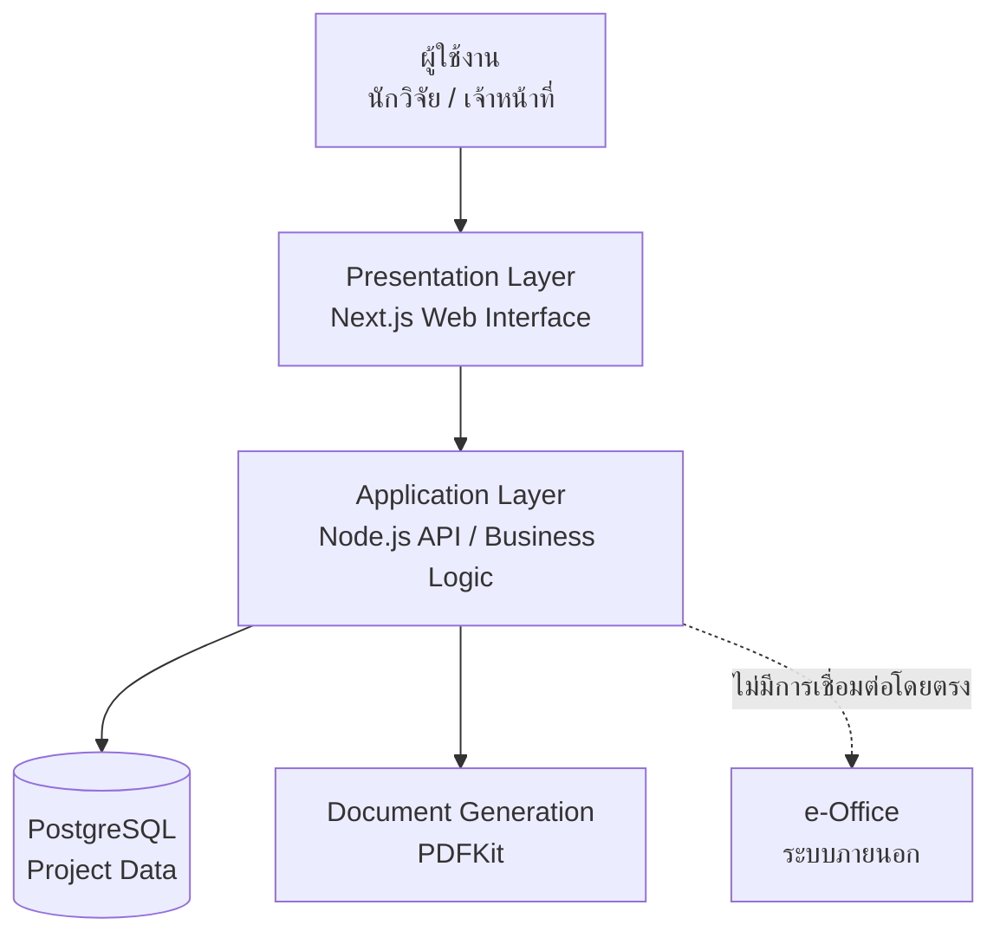
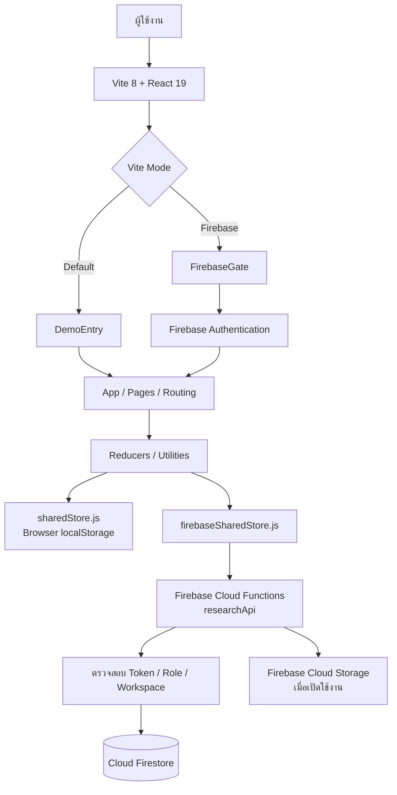
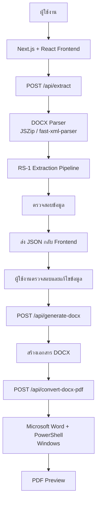
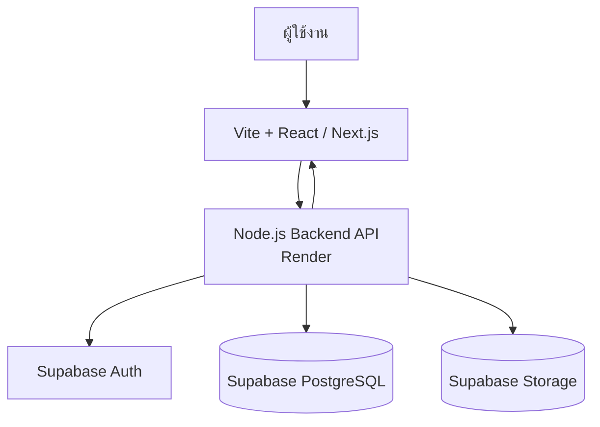

# การเปรียบเทียบสถาปัตยกรรมระบบ (Architecture Comparison)

**โครงการ:** ระบบบริหารจัดการทุนวิจัยส่วนตัว มหาวิทยาลัยแม่ฟ้าหลวง  
**ทีม:** 404 Team Found  
**เอกสาร:** การเปรียบเทียบสถาปัตยกรรมระบบ  
**เวอร์ชัน:** 2.1  
**สถานะ:** ปรับปรุงตาม Source Code, Prototype Audit และข้อเสนอแนะจากทีม

---

## 1. ภาพรวม

เอกสารฉบับนี้จัดทำขึ้นเพื่ออธิบายและเปรียบเทียบสถาปัตยกรรมของระบบบริหารจัดการทุนวิจัยส่วนตัว โดยพิจารณาจากสถาปัตยกรรมตามข้อเสนอโครงการ สถาปัตยกรรมที่พัฒนาขึ้นจริงใน Web Prototype และสถาปัตยกรรมทางเลือกสำหรับการพัฒนาในอนาคต

จากการตรวจสอบ Source Code พบว่าโครงการมีส่วนประกอบหลัก 2 ส่วน ได้แก่

1. **Main Web Prototype:** ระบบบริหารจัดการทุนวิจัยส่วนตัวที่พัฒนาด้วย Vite 8 และ React 19 รองรับ Local Demo และ Firebase Mode
2. **RS-1 Extraction POC:** ระบบต้นแบบสำหรับอ่าน สกัด ตรวจสอบ และสร้างเอกสาร RS-1 พัฒนาด้วย Next.js 15.5, React 19 และ TypeScript 5.8

ทั้งสองส่วนมีวัตถุประสงค์และโครงสร้างการทำงานแตกต่างกัน โดย RS-1 Extraction POC มี API สำหรับประมวลผลเอกสารของตนเอง และยังไม่พบการเชื่อมต่อกับฐานข้อมูลส่วนกลางของ Main Web Prototype

การเปรียบเทียบแบ่งออกเป็น 3 แนวทาง ได้แก่

1. **Proposed Architecture:** สถาปัตยกรรมตามข้อเสนอโครงการวิจัยฉบับเดิม
2. **Current Prototype Architecture:** สถาปัตยกรรมที่ใช้จริงใน Main Web Prototype และ RS-1 Extraction POC
3. **Alternative Architecture:** สถาปัตยกรรมทางเลือกที่อาจนำ Render และ Supabase มาใช้ในอนาคต

## 2. ตารางเปรียบเทียบสถาปัตยกรรม 3 แนวทาง

| องค์ประกอบ | Proposed Architecture | Current Prototype Architecture | Alternative Architecture |
|---|---|---|---|
| Frontend | Next.js Web Interface | Main Web: Vite 8 + React 19 / RS-1 POC: Next.js 15.5 + React 19 | Vite + React หรือ Next.js |
| Programming Language | ไม่ได้ระบุ | Main Web: JavaScript / RS-1 POC: TypeScript 5.8 | JavaScript หรือ TypeScript |
| Backend | Node.js API / Business Logic Layer | Main Web: Firebase Cloud Functions (Node.js 22) / RS-1 POC: Next.js Route Handlers | Node.js API บน Render |
| API | Backend API | Main Web: `/api/research` / RS-1 POC: `/api/extract`, `/api/generate-docx`, `/api/convert-docx-pdf` | REST API |
| Authentication | Role-based Access Control และ Project Ownership | Main Web: Firebase Authentication ใน Firebase Mode / Local Demo จำลองบทบาท / RS-1 POC ไม่พบ Authentication | Supabase Auth |
| Database | PostgreSQL | Main Web: Cloud Firestore ใน Firebase Mode / Local Demo: localStorage / RS-1 POC: ยังไม่พบฐานข้อมูลส่วนกลาง | Supabase PostgreSQL |
| File Storage | ไม่ได้ระบุรายละเอียด | Main Web: Firebase Cloud Storage เมื่อเปิดใช้งาน / RS-1 POC: ประมวลผลไฟล์ผ่าน Server ชั่วคราว | Supabase Storage |
| Document Processing | PDFKit | Main Web: Mammoth.js, PDF.js และ jsPDF / RS-1 POC: JSZip, fast-xml-parser และ word-extractor | Document Processing Libraries |
| PDF Conversion | PDFKit ตามแนวทางในข้อเสนอ | RS-1 POC: Microsoft Word และ PowerShell บน Windows | PDFKit หรือบริการแปลงเอกสาร |
| Notification | ไม่ได้ระบุรายละเอียด | Main Web: In-app Notifications / ยังไม่มี Email Sender | Notification Service |
| Hosting | Cloudflare (ตัวเลือกที่เสนอ) | Main Web: มีการกำหนดค่า Firebase Hosting / RS-1 POC: Next.js Development Server | Render |
| e-Office Integration | ไม่มีการเชื่อมต่อโดยตรง | ไม่มี API เชื่อมต่อ e-Office โดยตรง | ต้องพัฒนา Integration เพิ่มเติม |

**หมายเหตุ:**

- Current Prototype แสดงสถาปัตยกรรมของระบบหลักและ RS-1 Extraction POC แยกกัน ไม่ได้หมายความว่าทั้งสองส่วนเชื่อมต่อกันครบถ้วน
- Local Demo เป็นการจำลองการทำงานใน Browser ไม่ใช่ระบบฐานข้อมูลส่วนกลาง
- Firebase Mode รองรับการเชื่อมต่อ Authentication, Cloud Functions และ Firestore
- RS-1 Extraction POC ยังไม่พบการเชื่อมต่อกับฐานข้อมูลส่วนกลางหรือ Firebase Authentication
- Render และ Supabase เป็นเพียงทางเลือก ยังไม่พบการใช้งานจริงใน Source Code ที่ตรวจสอบ

## 3. สถาปัตยกรรมตามข้อเสนอโครงการ (Proposed Architecture)

### 3.1 ภาพรวมสถาปัตยกรรม

ตามข้อเสนอโครงการ ระบบถูกออกแบบให้มีองค์ประกอบหลักดังนี้

| Layer / Component | เทคโนโลยี | หน้าที่ |
|---|---|---|
| Presentation Layer | Next.js | ส่วนติดต่อผู้ใช้งานสำหรับนักวิจัยและเจ้าหน้าที่ |
| Application Layer | Node.js API / Business Logic | ประมวลผลคำขอ ตรวจสอบข้อมูล และจัดการสิทธิ์ |
| Data Layer | PostgreSQL | จัดเก็บข้อมูลผู้ใช้งานและข้อมูลโครงการ |
| Document Generation | PDFKit | สร้างเอกสาร PDF |
| Deployment Layer | Cloudflare (ตัวเลือกที่เสนอ) | ให้บริการระบบ |

ระบบออกแบบให้มีการตรวจสอบสิทธิ์ตามบทบาทผู้ใช้งาน (Role-based Access Control) และตรวจสอบความเป็นเจ้าของโครงการ (Project Ownership Checks)

### 3.2 ลำดับการทำงาน

1. ผู้ใช้งานเข้าสู่ระบบผ่าน Web Interface
2. Frontend ส่งคำขอไปยัง Backend API
3. Backend ตรวจสอบข้อมูลและสิทธิ์การเข้าถึง
4. Backend ติดต่อ PostgreSQL เพื่ออ่านหรือบันทึกข้อมูล
5. ระบบใช้ PDFKit สร้างเอกสาร PDF ตามข้อมูลที่กำหนด
6. Backend ส่งผลการประมวลผลกลับไปยัง Frontend

### 3.3 แผนภาพสถาปัตยกรรมตามข้อเสนอโครงการ

## 4. สถาปัตยกรรม Main Web Prototype

### 4.1 ภาพรวม

Main Web Prototype พัฒนาด้วย Vite 8 และ React 19 โดยใช้ JavaScript (ES Modules) และแยกการทำงานเป็น 2 โหมด ได้แก่ Local Demo และ Firebase Mode

### 4.2 Local Demo Architecture

Local Demo เป็นโหมดสำหรับสาธิตและทดลองการทำงานของระบบ โดยมีองค์ประกอบดังนี้

| Component | หน้าที่ |
|---|---|
| DemoEntry | แสดงหน้าสำหรับเลือกบทบาทผู้ใช้งานเพื่อทดลองระบบ |
| App / Pages | แสดงหน้าจอและจัดการการทำงานตามบทบาท |
| Hash-based Routing | จัดการเส้นทางการเปลี่ยนหน้า |
| Reducers / Utilities | ประมวลผลข้อมูลและการเปลี่ยนแปลงสถานะ |
| sharedStore.js | จัดการข้อมูลตัวอย่างและข้อมูลใน Local Store |
| Browser localStorage | จัดเก็บข้อมูลจำลองและข้อมูลร่างภายใน Browser |

**ลำดับการทำงาน**

1. ผู้ใช้งานเปิด Web Application ผ่าน Browser
2. ระบบแสดง DemoEntry เพื่อเลือกบทบาทสำหรับทดลอง
3. App และ Routing แสดงหน้าจอตามบทบาทที่เลือก
4. ผู้ใช้งานดำเนินการผ่าน Pages และ Utilities
5. Reducers ประมวลผลคำสั่งและปรับปรุงข้อมูล
6. sharedStore.js จัดการการบันทึกข้อมูลผ่าน localStorage

**ข้อจำกัด**

- การเลือกบทบาทเป็นการจำลอง ไม่ใช่การยืนยันตัวตนจริง
- ข้อมูลถูกจัดเก็บใน Browser ของผู้ใช้งาน
- ไม่ใช่ฐานข้อมูลส่วนกลางสำหรับการใช้งานหลายผู้ใช้
- ข้อมูลตัวอย่างบางส่วนเป็น Mock Data และไม่ใช่ข้อมูลโครงการจริงที่ได้รับการยืนยัน

### 4.3 Firebase Mode Architecture

Firebase Mode เป็นโหมดที่รองรับการเข้าสู่ระบบและจัดการข้อมูลผ่านบริการ Firebase

| Component | เทคโนโลยี | หน้าที่ |
|---|---|---|
| Frontend | Vite 8 + React 19 | แสดงหน้าจอและรับคำสั่งจากผู้ใช้งาน |
| Authentication | Firebase Authentication | ตรวจสอบตัวตนผู้ใช้งาน |
| Data Store | firebaseSharedStore.js | เชื่อมต่อและจัดการข้อมูลจาก Firebase |
| Backend | Firebase Cloud Functions | ประมวลผลคำขอจาก Frontend |
| Runtime | Node.js 22 | Runtime ของ Backend Functions |
| API | `researchApi` | รับคำขอและประมวลผลคำสั่ง |
| Database | Cloud Firestore | จัดเก็บข้อมูลโครงการและข้อมูลที่เกี่ยวข้อง |
| File Storage | Firebase Cloud Storage | จัดเก็บไฟล์เมื่อเปิดใช้งานบริการ |
| Authorization | Server-side Authorization และ Firestore Security Rules | ตรวจสอบบทบาท Workspace และสิทธิ์การเข้าถึง |

### 4.4 ลำดับการทำงานของ Firebase Mode

1. ผู้ใช้งานเข้าถึง Web Application ผ่าน Browser
2. FirebaseGate แสดงหน้าสำหรับเข้าสู่ระบบ
3. Firebase Authentication ตรวจสอบตัวตนผู้ใช้งาน
4. ระบบอ่านข้อมูล Profile เพื่อระบุ UID, Role และ Workspace
5. Frontend ติดต่อ Firebase Store เพื่ออ่านข้อมูลจาก Firestore
6. เมื่อมีการบันทึกข้อมูล Frontend ส่งคำขอไปยัง `researchApi` ผ่าน HTTP POST พร้อม Firebase ID Token
7. Backend ตรวจสอบ Token, Profile, Role และ Workspace
8. Backend ตรวจสอบสิทธิ์และประมวลผลคำสั่ง
9. ระบบบันทึกข้อมูลผ่าน Firestore Transaction ตามการทำงานที่กำหนด
10. Backend ส่งผลการประมวลผลกลับไปยัง Frontend

### 4.5 แผนภาพ Main Web Prototype

**ภาพรวม Local Demo และ Firebase Mode**

### 4.6 โครงสร้างข้อมูลและการควบคุมสิทธิ์

ใน Firebase Mode มีการจัดเก็บข้อมูลผ่าน Cloud Firestore โดยพบโครงสร้างหลักดังนี้

| Firestore Path | หน้าที่ |
|---|---|
| `users/{uid}` | จัดเก็บข้อมูลผู้ใช้งาน |
| `workspaces/{workspace}/projects/{projectId}` | จัดเก็บข้อมูลโครงการหลัก |
| `workspaces/{workspace}/projects/{projectId}/activity` | จัดเก็บประวัติการดำเนินงาน |
| `workspaces/{workspace}/users/{uid}/projects/{projectId}` | จัดเก็บข้อมูลโครงการที่ผู้ใช้งานมีสิทธิ์เข้าถึง |
| `workspaces/{workspace}/users/{uid}/notifications` | จัดเก็บการแจ้งเตือนของผู้ใช้งาน |
| `uploadTickets/{ticketId}` | จัดเก็บข้อมูลอ้างอิงการอัปโหลด |

การควบคุมสิทธิ์ประกอบด้วยการตรวจสอบ Token, Role, Workspace และ Server Authorization รวมถึงการกำหนด Firestore Security Rules

**ข้อควรทราบ:** การมีโค้ด Authentication, API และ Storage ใน Source Code ไม่ได้ยืนยันว่าบริการทั้งหมดได้รับการ Deploy และผ่านการทดสอบ Live ใน Production แล้ว

## 5. สถาปัตยกรรม RS-1 Extraction POC

### 5.1 ภาพรวม

RS-1 Extraction POC เป็นระบบต้นแบบสำหรับการประมวลผลเอกสารข้อเสนอโครงการวิจัย RS-1 โดยมีวัตถุประสงค์เพื่อทดลองกระบวนการอ่านเอกสาร สกัดข้อมูล ตรวจสอบข้อมูล และสร้างเอกสารกลับมาในรูปแบบ DOCX และ PDF

ระบบพัฒนาด้วย Next.js 15.5, React 19 และ TypeScript 5.8 โดยใช้ Next.js Route Handlers สำหรับประมวลผลคำขอฝั่ง Server

**องค์ประกอบหลัก**

| Component | เทคโนโลยี | หน้าที่ |
|---|---|---|
| Frontend | Next.js 15.5 + React 19 | แสดงหน้าจอและรับข้อมูลจากผู้ใช้งาน |
| Programming Language | TypeScript 5.8 | พัฒนาระบบและกำหนดชนิดข้อมูล |
| Backend API | Next.js Route Handlers | ประมวลผลคำขอจาก Frontend |
| DOCX Processing | JSZip และ fast-xml-parser | อ่านโครงสร้างไฟล์ DOCX และข้อมูล XML |
| Data Validation | Zod | ตรวจสอบรูปแบบและความถูกต้องของข้อมูล |
| Legacy DOC Processing | word-extractor | อ่านไฟล์ Word รุ่นเก่า `.doc` |
| Draft Storage | Browser localStorage | จัดเก็บข้อมูลร่างใน Browser |
| File Processing | Node.js File System และ Temporary Directory | ประมวลผลไฟล์ชั่วคราวบน Server |

### 5.2 API และหน้าที่

| API Endpoint | หน้าที่ |
|---|---|
| `/api/extract` | รับไฟล์ DOCX และสกัดข้อมูลผ่าน RS-1 Extraction Pipeline |
| `/api/generate-docx` | รับข้อมูลจากผู้ใช้งานและสร้างเอกสาร DOCX |
| `/api/convert-docx-pdf` | แปลงไฟล์ DOCX เป็น PDF ผ่าน Microsoft Word และ PowerShell บน Windows |

### 5.3 ลำดับการทำงาน

**ขั้นตอนการสกัดข้อมูล**

1. ผู้ใช้งานเลือกไฟล์ DOCX
2. Frontend ส่งไฟล์ไปยัง `/api/extract`
3. Server ตรวจสอบชนิดไฟล์และขนาดไฟล์
4. ระบบใช้ Library สำหรับอ่านโครงสร้างเอกสาร DOCX
5. RS-1 Extraction Pipeline ประมวลผลและสกัดข้อมูล
6. Server ส่งผลลัพธ์กลับไปยัง Frontend ในรูปแบบ JSON
7. ผู้ใช้งานตรวจสอบและแก้ไขข้อมูลที่สกัดได้

**ขั้นตอนการสร้างเอกสาร**

1. ผู้ใช้งานตรวจสอบและแก้ไขข้อมูลในแบบฟอร์ม
2. Frontend ส่งข้อมูลไปยัง `/api/generate-docx`
3. Server ประมวลผลข้อมูลและสร้างเอกสาร DOCX
4. ระบบส่งไฟล์ DOCX กลับไปยัง Frontend
5. หากต้องการแสดง PDF Preview ระบบส่งไฟล์ DOCX ไปยัง `/api/convert-docx-pdf`
6. Server ใช้ Microsoft Word ผ่าน PowerShell บน Windows เพื่อสร้างไฟล์ PDF
7. ระบบส่งไฟล์ PDF กลับไปยัง Frontend

### 5.4 แผนภาพ RS-1 Extraction POC

### 5.5 การจัดเก็บข้อมูลและข้อจำกัด

จากการตรวจสอบ Source Code พบว่า RS-1 Extraction POC ใช้ Browser localStorage ผ่าน Key `rs1-project-draft` สำหรับบันทึกข้อมูลร่างของผู้ใช้งาน

ยังไม่พบการเชื่อมต่อกับฐานข้อมูลส่วนกลางหรือ Firebase Authentication ใน POC ส่วนนี้

ข้อจำกัดที่พบ ได้แก่

- ข้อมูลร่างอยู่ภายใน Browser ไม่ใช่ฐานข้อมูลส่วนกลาง
- ยังไม่พบระบบ Authentication สำหรับยืนยันตัวตนผู้ใช้งาน
- การประมวลผลไฟล์ใน API มีการจำกัดขนาดไฟล์ไม่เกิน 10 MB
- API `/api/convert-docx-pdf` รองรับการทำงานบน Windows ที่ติดตั้ง Microsoft Word เท่านั้น
- การนำระบบไป Deploy บน Server ที่ไม่ใช่ Windows จำเป็นต้องปรับกระบวนการแปลง PDF
- การสกัดข้อมูลจากเอกสารเป็นไปตาม Pipeline ที่พัฒนาขึ้น ยังไม่ควรกล่าวอ้างว่าเป็น OCR หรือ AI Extraction หากไม่มีหลักฐานรองรับ

## 6. ความสัมพันธ์ระหว่าง Main Web Prototype และ RS-1 Extraction POC

แม้ทั้งสองส่วนจะอยู่ภายใต้โครงการเดียวกัน แต่จาก Source Code ที่ตรวจสอบพบว่ามีโครงสร้างและการจัดการข้อมูลแยกจากกัน

| ประเด็น | Main Web Prototype | RS-1 Extraction POC |
|---|---|---|
| Framework | Vite 8 + React 19 | Next.js 15.5 + React 19 |
| Language | JavaScript | TypeScript 5.8 |
| Backend | Firebase Cloud Functions ใน Firebase Mode | Next.js Route Handlers |
| Authentication | Firebase Authentication ใน Firebase Mode | ยังไม่พบ |
| Database | Firestore ใน Firebase Mode | ยังไม่พบฐานข้อมูลส่วนกลาง |
| Local Storage | ใช้ใน Local Demo | ใช้เก็บข้อมูลร่าง |
| Document Processing | อ่าน DOCX/PDF และสร้าง PDF ตามส่วนที่พัฒนา | สกัดข้อมูล RS-1 และสร้าง DOCX/PDF |
| API | `/api/research` | `/api/extract`, `/api/generate-docx`, `/api/convert-docx-pdf` |
| Integration | Firebase Services | ยังไม่พบการเชื่อมต่อกับ Main Web Prototype ใน Source Code ที่ตรวจสอบ |

**ข้อสรุปเรื่องการเชื่อมต่อ**

ปัจจุบันควรอธิบาย RS-1 Extraction POC ว่าเป็นระบบต้นแบบสำหรับทดลองกระบวนการประมวลผลเอกสารแยกจาก Main Web Prototype ไม่ควรระบุว่าข้อมูลที่สกัดจาก POC ถูกส่งเข้า Firestore หรือบันทึกลงโครงการหลักโดยอัตโนมัติ หากยังไม่มีหลักฐานการเชื่อมต่อดังกล่าว

## 7. สถาปัตยกรรมทางเลือก: Render + Supabase

### 7.1 ภาพรวม

ทีมอาจพิจารณาใช้ Render และ Supabase เป็นทางเลือกสำหรับการพัฒนาระบบในอนาคต โดยใช้ Render สำหรับ Hosting และ Backend API และ Supabase สำหรับฐานข้อมูล PostgreSQL, Authentication และ File Storage

| Component | เทคโนโลยี | หน้าที่ |
|---|---|---|
| Frontend | Vite + React หรือ Next.js | ส่วนติดต่อผู้ใช้งาน |
| Backend | Node.js API | ประมวลผลคำขอและ Business Logic |
| Hosting | Render | ให้บริการ Web Application และ Backend |
| Database | Supabase PostgreSQL | จัดเก็บข้อมูลส่วนกลาง |
| Authentication | Supabase Auth | ตรวจสอบตัวตนผู้ใช้งาน |
| File Storage | Supabase Storage | จัดเก็บเอกสารและไฟล์ |

### 7.2 ลำดับการทำงาน

1. ผู้ใช้งานเข้าถึง Web Application
2. Frontend ส่งคำขอไปยัง Backend API
3. Backend ตรวจสอบตัวตนและสิทธิ์การเข้าถึง
4. Backend ติดต่อ PostgreSQL เพื่ออ่านหรือบันทึกข้อมูล
5. ระบบจัดเก็บเอกสารผ่าน Supabase Storage
6. Backend ส่งผลลัพธ์กลับไปยัง Frontend

### 7.3 แผนภาพสถาปัตยกรรมทางเลือก

**ข้อจำกัดในการเปลี่ยนสถาปัตยกรรม**

การเปลี่ยนจาก Firebase มาเป็น Render และ Supabase ต้องปรับปรุง Backend, Authentication, Database, File Storage และการควบคุมสิทธิ์ใหม่ รวมถึงต้องวางแผน Data Migration และทดสอบการทำงานของระบบก่อนนำไปใช้งานจริง

ปัจจุบันยังไม่พบการนำ Render และ Supabase มาใช้งานจริงใน Source Code ของโครงการ

## 8. ตารางเปรียบเทียบข้อดีและข้อจำกัดของสถาปัตยกรรม

| แนวทาง | ข้อดี | ข้อจำกัด | เหตุผลในการเลือกใช้หรือพิจารณา |
|---|---|---|---|
| Proposed Architecture | มีการแบ่ง Presentation, Application และ Data Layer ชัดเจน | เป็นแนวทางตามข้อเสนอ ไม่ใช่โครงสร้างที่ใช้จริงทั้งหมดใน Prototype | ใช้เป็นสถาปัตยกรรมอ้างอิง |
| Main Web - Local Demo | ทดลองหน้าจอและ Workflow ได้โดยไม่ต้องเชื่อมต่อ Backend จริง | ข้อมูลจำลองและการเลือกบทบาทไม่ใช่ระบบ Authentication จริง | ใช้สำหรับสาธิตและตรวจสอบการทำงานของ UI |
| Main Web - Firebase Mode | รองรับ Authentication, Backend API, Firestore และการควบคุมสิทธิ์ | ต้องตั้งค่า Firebase Services และตรวจสอบความพร้อมก่อน Production | ใช้โครงสร้างที่มี Source Code รองรับแล้ว และรองรับการจัดเก็บข้อมูลส่วนกลาง |
| RS-1 Extraction POC | แยกกระบวนการประมวลผลเอกสารออกเป็น API และ Pipeline | ยังไม่มีฐานข้อมูลส่วนกลางและมีข้อจำกัดด้านการแปลง PDF บน Windows | ใช้ทดลองการสกัดข้อมูลและสร้างเอกสาร RS-1 |
| Alternative - Render + Supabase | รองรับ Node.js Backend และ PostgreSQL รวมถึง Authentication และ Storage | ต้องปรับ Backend, ย้ายข้อมูล และออกแบบสิทธิ์ใหม่ | พิจารณาเป็นทางเลือกสำหรับการพัฒนาในอนาคต |

## 9. ขอบเขตการเชื่อมต่อระบบภายนอก

ระบบบริหารจัดการทุนวิจัยส่วนตัวมีวัตถุประสงค์เพื่อสนับสนุนการจัดการข้อมูลโครงการ การจัดทำข้อเสนอโครงการ การติดตามสถานะ การจัดการเอกสาร และการประเมินรายงานตามขอบเขตของระบบ

อย่างไรก็ตาม กระบวนการที่เกี่ยวข้องกับระบบภายนอกและขั้นตอนอย่างเป็นทางการของมหาวิทยาลัยยังคงต้องดำเนินการตามช่องทางที่กำหนด

- การส่งเอกสารอย่างเป็นทางการผ่านระบบ e-Office
- การพิจารณาของหน่วยงานต้นสังกัด
- การรับทราบหรือดำเนินการของคณะกรรมการ
- การดำเนินการตามขั้นตอนทางราชการหรือขั้นตอนของมหาวิทยาลัย

จากการตรวจสอบ Source Code ยังไม่พบ API สำหรับเชื่อมต่อ e-Office โดยตรง และยังไม่พบ Email Sender หรือ Scheduler สำหรับส่งอีเมลจริง

ระบบมี In-app Notifications สำหรับแสดงการแจ้งเตือนภายในแอปพลิเคชัน แต่ไม่ควรนับเป็นการส่งอีเมล

## 10. สถานะการทำงานและข้อจำกัดของ Prototype

จาก Prototype Audit วันที่ 14 พฤศจิกายน 2569 พบว่าฟังก์ชันของระบบมีสถานะการพัฒนาแตกต่างกัน จึงต้องแยกความสามารถที่มีโค้ดรองรับออกจากความสามารถที่ผ่านการทดสอบและใช้งานได้ครบตาม Requirement

| กลุ่มการทำงาน | สถานะจาก Audit | ข้อค้นพบ |
|---|---|---|
| Identity / Roles | Partial / Mock | Local role selection เป็น Mock ส่วน Firebase Authentication ยังต้องตรวจสอบการทำงานแบบ Live |
| Project Read / Access Control | Partial | มีการควบคุมข้อมูลตาม Workspace และสิทธิ์ แต่ยังมีประเด็นด้านการแสดงข้อมูลบางส่วน |
| Dashboard / Search / Filter | Working / Partial | ทำงานกับข้อมูล Seed และ Legacy Status แต่ยังมีข้อมูลและสถานะที่ไม่ครอบคลุม |
| Create / Save Draft | Working / Partial | มี Local Draft Persistence แต่ต้องแยกพฤติกรรม Local และ Firebase |
| RS-1 Structured Editor | Partial | มีฟอร์มและตัวเลือกข้อมูล แต่บางรายการยังรอการยืนยันจากผู้เกี่ยวข้อง |
| Import / Extract / Review | Partial | มี Parser สำหรับสกัดข้อมูล 9 Fields แต่ไม่มี OCR และยังต้องตรวจสอบความแม่นยำ |
| Proposal PDF | Partial | สร้าง PDF ได้ แต่ยังไม่ตรงกับแบบฟอร์มต้นฉบับและพื้นที่ลงนามทั้งหมด |
| Submission Evidence / Consent | Not Implemented | ยังขาดการตรวจสอบเอกสารลงนามและข้อมูล Consent ตามข้อกำหนด |
| Project Changes / Extension | Partial | มีการบันทึกการเปลี่ยนแปลงบางส่วน แต่ยังไม่ครบตามเงื่อนไขที่กำหนด |
| Reviewer Assignment | Partial | มีระบบมอบหมายผู้ประเมิน แต่ยังไม่บังคับจำนวนผู้ประเมินให้ครบ 3 คน |
| Evaluation | Partial | มีแบบฟอร์มและการบันทึกผล แต่เงื่อนไขการประเมินและการปล่อยผลยังไม่ครบ |
| Evaluation PDF | Not Implemented | ยังไม่มีระบบสร้าง PDF ผลการประเมินโดยตรง |
| Cancellation | Not Implemented | ยังไม่มี Workflow การยกเลิกโครงการครบตามข้อกำหนด |
| Notifications | Partial | มี In-app Notifications แต่ไม่มีระบบส่งอีเมลจริง |
| e-Office Integration | Not Implemented | ไม่มี API เชื่อมต่อโดยตรง |

**หมายเหตุ:** สถานะ Partial, Mock และ Not Implemented เป็นสถานะตามผลการตรวจสอบ Prototype ไม่ใช่ผลการตรวจรับหรือการอนุมัติจากผู้มีส่วนเกี่ยวข้อง

## 11. สรุปผลการเปรียบเทียบ

จากการตรวจสอบเอกสารและ Source Code พบว่าโครงการมีการพัฒนาสถาปัตยกรรมแยกตามลักษณะการทำงานของแต่ละส่วน

Main Web Prototype ใช้ Vite 8 และ React 19 โดยรองรับ Local Demo และ Firebase Mode ซึ่ง Local Demo ใช้ Browser localStorage สำหรับข้อมูลจำลอง ส่วน Firebase Mode ใช้ Firebase Authentication, Firebase Cloud Functions และ Cloud Firestore สำหรับการยืนยันตัวตน ประมวลผลคำขอ และจัดเก็บข้อมูลส่วนกลาง

RS-1 Extraction POC เป็นระบบต้นแบบอีกส่วนหนึ่งที่ใช้ Next.js 15.5, React 19 และ TypeScript 5.8 โดยใช้ Next.js Route Handlers สำหรับสกัดข้อมูลจาก DOCX สร้าง DOCX และแปลง DOCX เป็น PDF ทั้งนี้ยังไม่พบการเชื่อมต่อฐานข้อมูลส่วนกลางหรือการเชื่อมต่อกับ Main Web Prototype ใน Source Code ที่ตรวจสอบ

สำหรับการประมวลผลเอกสาร RS-1 มีการใช้ JSZip และ fast-xml-parser ในการอ่านโครงสร้างเอกสาร และใช้ Microsoft Word ร่วมกับ PowerShell บน Windows สำหรับแปลง DOCX เป็น PDF ซึ่งเป็นข้อจำกัดสำคัญหากต้องนำระบบไป Deploy บนสภาพแวดล้อมอื่น

เมื่อเปรียบเทียบกับข้อเสนอโครงการเดิม พบว่ามีการปรับเปลี่ยนเทคโนโลยีและโครงสร้างการทำงานบางส่วนตามแนวทางการพัฒนา Prototype โดยระบบหลักเลือกใช้ Firebase Services ขณะที่ RS-1 Extraction POC ใช้ Next.js สำหรับประมวลผลเอกสารแยกต่างหาก

สำหรับ Render และ Supabase เป็นทางเลือกที่อาจนำมาพิจารณาในอนาคต แต่ยังต้องประเมินผลกระทบด้านการย้ายข้อมูล การปรับ Backend และการควบคุมสิทธิ์ก่อนตัดสินใจ

ทั้งนี้ Prototype ยังมีฟังก์ชันบางส่วนที่อยู่ในสถานะ Partial, Mock และ Not Implemented จึงต้องดำเนินการปรับปรุงตาม Gap Analysis และยืนยันข้อกำหนดกับผู้เกี่ยวข้องก่อนนำระบบไปใช้งานจริง

## 12. เอกสารอ้างอิง

1. 404 Team Found, *Personal Research Grant Management System for Mae Fah Luang University: Research / Project Proposal*.
2. 404 Team Found, *MFU Research Grant Management Web Prototype Source Code*, November 2026.
3. `prototype/MFU-Research-Grant-UI-Demo/package.json` — Dependencies และ Scripts ของ Main Web Prototype
4. `prototype/MFU-Research-Grant-UI-Demo/functions/package.json` — Dependencies และ Node.js Runtime ของ Backend
5. `prototype/MFU-Research-Grant-UI-Demo/vite.config.js` — การตั้งค่า Vite Mode และ Store Alias
6. `prototype/MFU-Research-Grant-UI-Demo/firebase.json` — การตั้งค่า Firebase Hosting และ Cloud Functions
7. `prototype/MFU-Research-Grant-UI-Demo/src/utils/firebaseClient.js` — การเชื่อมต่อ Firebase Services
8. `prototype/MFU-Research-Grant-UI-Demo/src/utils/firebaseSharedStore.js` — การจัดการข้อมูลใน Firebase Mode
9. `prototype/MFU-Research-Grant-UI-Demo/src/utils/sharedStore.js` — การจัดการข้อมูลใน Local Demo
10. `prototype/rs1-extraction/package.json` — Dependencies ของ RS-1 Extraction POC
11. `prototype/rs1-extraction/app/api/extract/route.ts` — API สำหรับสกัดข้อมูลจาก DOCX
12. `prototype/rs1-extraction/app/api/generate-docx/route.ts` — API สำหรับสร้างเอกสาร DOCX
13. `prototype/rs1-extraction/app/api/convert-docx-pdf/route.ts` — API สำหรับแปลง DOCX เป็น PDF
14. `prototype/rs1-extraction/lib/docx.ts` — การอ่านและประมวลผลเอกสาร DOCX
15. `prototype/rs1-extraction/scripts/convert-docx-to-pdf.ps1` — Script สำหรับแปลง DOCX เป็น PDF ผ่าน Microsoft Word บน Windows
16. `prototype/MFU-Research-Grant-UI-Demo/docs/audit/01_SYSTEM_OVERVIEW.md` — ภาพรวมระบบและผลการตรวจสอบ
17. `prototype/MFU-Research-Grant-UI-Demo/docs/audit/03_CURRENT_FEATURE_INVENTORY.md` — รายการฟังก์ชันและสถานะการทำงาน
18. `prototype/MFU-Research-Grant-UI-Demo/docs/audit/04_GAP_ANALYSIS.md` — ผลการวิเคราะห์ช่องว่างของระบบ
19. `prototype/MFU-Research-Grant-UI-Demo/docs/final/DEPLOYMENT_READINESS.md` — สถานะความพร้อมสำหรับการ Deploy
20. `README.md` — ขอบเขตและวิธีการใช้งาน Web Prototype
