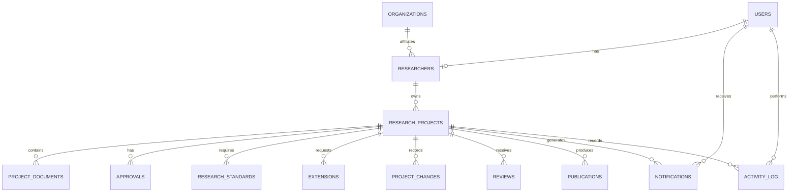

# แบบจำลองข้อมูลระบบ (Data Model)

**โครงการ:** ระบบบริหารจัดการทุนวิจัยส่วนตัว มหาวิทยาลัยแม่ฟ้าหลวง  
**ทีม:** 404 Team Found  
**เอกสาร:** แบบจำลองข้อมูลระบบ  
**เวอร์ชัน:** 2.0 (Draft)  
**สถานะ:** ปรับปรุงโดยเทียบกับ Source Code ของ Web Prototype (17 พฤศจิกายน 2026)

## 1. ภาพรวม

เอกสารฉบับนี้จัดทำขึ้นเพื่ออธิบายโครงสร้างข้อมูลของระบบบริหารจัดการทุนวิจัยส่วนตัว โดยออกแบบเพื่อจัดเก็บและเชื่อมโยงข้อมูลที่เกี่ยวข้องกับผู้ใช้งาน นักวิจัย หน่วยงาน โครงการวิจัย เอกสารประกอบโครงการ การอนุมัติ มาตรฐานการวิจัย การขยายเวลา การเปลี่ยนแปลงโครงการ การประเมิน ผลงานเผยแพร่ การแจ้งเตือน และประวัติการดำเนินงาน

เอกสารนี้แยกการนำเสนอข้อมูลออกเป็น 2 ระดับ ได้แก่ (1) Conceptual Data Model สำหรับอธิบายข้อมูลทางธุรกิจตามข้อเสนอโครงการ และ (2) Physical Data Model สำหรับอธิบายโครงสร้าง Cloud Firestore ที่พบใน Source Code ของ Web Prototype ณ วันที่ตรวจสอบ ทั้งสองระดับไม่ใช่สิ่งเดียวกัน และการมี Entity ใน Conceptual Model ไม่ได้ยืนยันว่า Entity นั้นถูกพัฒนาเป็น Collection แยกใน Prototype แล้ว

## 2. Entity หลักของระบบ

แบบจำลองข้อมูลประกอบด้วย Entity หลักทั้งหมด 13 รายการ ดังนี้

| ลำดับ | Entity | รายละเอียด |
|---|---|---|
| 1 | USERS | จัดเก็บข้อมูลบัญชีผู้ใช้งานระบบ |
| 2 | RESEARCHERS | จัดเก็บข้อมูลประวัติและรายละเอียดของนักวิจัย |
| 3 | ORGANIZATIONS | จัดเก็บข้อมูลหน่วยงานหรือสำนักวิชาที่เกี่ยวข้อง |
| 4 | RESEARCH_PROJECTS | จัดเก็บข้อมูลโครงการวิจัยประเภททุนส่วนตัว |
| 5 | PROJECT_DOCUMENTS | จัดเก็บข้อมูลเอกสารและการอ้างอิงไฟล์ที่เกี่ยวข้องกับโครงการ |
| 6 | APPROVALS | จัดเก็บข้อมูลผลการพิจารณาและการอนุมัติโครงการ |
| 7 | RESEARCH_STANDARDS | จัดเก็บข้อมูลมาตรฐานหรือข้อกำหนดด้านการวิจัย |
| 8 | EXTENSIONS | จัดเก็บข้อมูลคำขอขยายระยะเวลาดำเนินงานวิจัย |
| 9 | PROJECT_CHANGES | จัดเก็บข้อมูลคำขอเปลี่ยนแปลงรายละเอียดโครงการ |
| 10 | REVIEWS | จัดเก็บข้อมูลการประเมินและผลการประเมินจากผู้ทรงคุณวุฒิ |
| 11 | PUBLICATIONS | จัดเก็บข้อมูลผลงานวิจัยและการเผยแพร่ผลงาน |
| 12 | NOTIFICATIONS | จัดเก็บข้อมูลการแจ้งเตือนผู้ใช้งาน |
| 13 | ACTIVITY_LOG | จัดเก็บประวัติการดำเนินการต่าง ๆ ภายในระบบ |

## 3. รายละเอียดโครงสร้างข้อมูลแต่ละ Entity

รายละเอียด Attribute ในหัวข้อนี้เป็นข้อเสนอเบื้องต้นสำหรับการออกแบบฐานข้อมูล โดยต้องตรวจสอบกับ Requirements และการพัฒนาระบบจริงอีกครั้ง

### 3.1 USERS (ข้อมูลผู้ใช้งาน)

ใช้จัดเก็บข้อมูลบัญชีผู้ใช้งานระบบ

| Attribute | Key | รายละเอียด |
|---|---|---|
| user_id | PK | รหัสผู้ใช้งานที่ไม่ซ้ำกัน |
| email | - | อีเมลของผู้ใช้งาน |
| password_hash | - | รหัสผ่านที่ผ่านการ Hash กรณีใช้ระบบรหัสผ่าน |
| role | - | บทบาทของผู้ใช้งาน เช่น นักวิจัย หรือเจ้าหน้าที่ |
| created_at | - | วันที่และเวลาที่สร้างบัญชี |
| updated_at | - | วันที่และเวลาที่แก้ไขข้อมูลล่าสุด |

### 3.2 RESEARCHERS (ข้อมูลนักวิจัย)

ใช้จัดเก็บข้อมูลประวัติและรายละเอียดของนักวิจัย

| Attribute | Key | รายละเอียด |
|---|---|---|
| researcher_id | PK | รหัสนักวิจัย |
| user_id | FK | อ้างอิงข้อมูลจาก USERS |
| full_name | - | ชื่อ-นามสกุลของนักวิจัย |
| organization_id | FK | อ้างอิงหน่วยงานจาก ORGANIZATIONS |
| contact_email | - | อีเมลสำหรับติดต่อ |

### 3.3 ORGANIZATIONS (ข้อมูลหน่วยงาน)

ใช้จัดเก็บข้อมูลสำนักวิชา หน่วยงาน หรือส่วนงานที่เกี่ยวข้อง

| Attribute | Key | รายละเอียด |
|---|---|---|
| organization_id | PK | รหัสหน่วยงาน |
| organization_name | - | ชื่อหน่วยงาน |
| organization_type | - | ประเภทของหน่วยงาน |

### 3.4 RESEARCH_PROJECTS (ข้อมูลโครงการวิจัย)

เป็น Entity หลักสำหรับจัดเก็บข้อมูลโครงการวิจัยประเภททุนส่วนตัว

| Attribute | Key | รายละเอียด |
|---|---|---|
| project_id | PK | รหัสโครงการวิจัย |
| project_code | - | รหัสอ้างอิงโครงการ |
| researcher_id | FK | อ้างอิงข้อมูลนักวิจัยจาก RESEARCHERS |
| project_title | - | ชื่อโครงการวิจัย |
| project_description | - | รายละเอียดโครงการวิจัย |
| start_date | - | วันที่เริ่มต้นโครงการ |
| end_date | - | วันที่สิ้นสุดโครงการ |
| status | - | สถานะปัจจุบันของโครงการ |
| created_at | - | วันที่และเวลาที่สร้างข้อมูล |
| updated_at | - | วันที่และเวลาที่แก้ไขข้อมูลล่าสุด |

### 3.5 PROJECT_DOCUMENTS (เอกสารประกอบโครงการ)

ใช้จัดเก็บข้อมูลเอกสารและการอ้างอิงไฟล์ที่เกี่ยวข้องกับโครงการวิจัย

| Attribute | Key | รายละเอียด |
|---|---|---|
| document_id | PK | รหัสเอกสาร |
| project_id | FK | อ้างอิงข้อมูลจาก RESEARCH_PROJECTS |
| document_type | - | ประเภทของเอกสาร |
| file_name | - | ชื่อไฟล์เอกสาร |
| file_path | - | ตำแหน่งหรือการอ้างอิงไฟล์ |
| uploaded_at | - | วันที่และเวลาที่อัปโหลดเอกสาร |

### 3.6 APPROVALS (ข้อมูลการพิจารณาและอนุมัติ)

ใช้จัดเก็บข้อมูลผลการพิจารณาและการอนุมัติที่เกี่ยวข้องกับโครงการ

| Attribute | Key | รายละเอียด |
|---|---|---|
| approval_id | PK | รหัสรายการพิจารณา |
| project_id | FK | อ้างอิงข้อมูลจาก RESEARCH_PROJECTS |
| approval_status | - | ผลหรือสถานะการพิจารณา |
| approval_date | - | วันที่พิจารณา |
| remarks | - | หมายเหตุเพิ่มเติม |

### 3.7 RESEARCH_STANDARDS (มาตรฐานการวิจัย)

ใช้จัดเก็บข้อมูลมาตรฐานหรือข้อกำหนดที่เกี่ยวข้องกับการดำเนินงานวิจัย

| Attribute | Key | รายละเอียด |
|---|---|---|
| standard_id | PK | รหัสมาตรฐานการวิจัย |
| project_id | FK | อ้างอิงข้อมูลจาก RESEARCH_PROJECTS |
| standard_type | - | ประเภทของมาตรฐานหรือข้อกำหนด |
| status | - | สถานะการดำเนินการหรือการพิจารณา |
| document_id | FK | อ้างอิงเอกสารจาก PROJECT_DOCUMENTS หากมี |

### 3.8 EXTENSIONS (ข้อมูลการขอขยายเวลา)

ใช้จัดเก็บข้อมูลคำขอขยายระยะเวลาดำเนินงานวิจัย

| Attribute | Key | รายละเอียด |
|---|---|---|
| extension_id | PK | รหัสคำขอขยายเวลา |
| project_id | FK | อ้างอิงข้อมูลจาก RESEARCH_PROJECTS |
| request_date | - | วันที่ยื่นคำขอ |
| requested_duration | - | ระยะเวลาที่ต้องการขยาย |
| reason | - | เหตุผลในการขอขยายเวลา |
| status | - | สถานะของคำขอ |

### 3.9 PROJECT_CHANGES (ข้อมูลการเปลี่ยนแปลงโครงการ)

ใช้จัดเก็บข้อมูลคำขอเปลี่ยนแปลงรายละเอียดของโครงการวิจัย

| Attribute | Key | รายละเอียด |
|---|---|---|
| change_id | PK | รหัสรายการเปลี่ยนแปลง |
| project_id | FK | อ้างอิงข้อมูลจาก RESEARCH_PROJECTS |
| change_type | - | ประเภทของการเปลี่ยนแปลง |
| change_reason | - | เหตุผลในการขอเปลี่ยนแปลง |
| request_date | - | วันที่ยื่นคำขอ |
| status | - | สถานะของคำขอ |

### 3.10 REVIEWS (ข้อมูลการประเมิน)

ใช้จัดเก็บข้อมูลการประเมินและผลการประเมินจากผู้ทรงคุณวุฒิ

| Attribute | Key | รายละเอียด |
|---|---|---|
| review_id | PK | รหัสรายการประเมิน |
| project_id | FK | อ้างอิงข้อมูลจาก RESEARCH_PROJECTS |
| reviewer_name | - | ชื่อหรือข้อมูลอ้างอิงผู้ประเมิน |
| review_result | - | ผลการประเมิน |
| comments | - | ความคิดเห็นและข้อเสนอแนะจากผู้ประเมิน |
| review_date | - | วันที่ประเมินเสร็จสิ้น |

### 3.11 PUBLICATIONS (ข้อมูลผลงานเผยแพร่)

ใช้จัดเก็บข้อมูลผลงานวิจัยและการเผยแพร่ผลงานที่เกี่ยวข้องกับโครงการ

| Attribute | Key | รายละเอียด |
|---|---|---|
| publication_id | PK | รหัสผลงานเผยแพร่ |
| project_id | FK | อ้างอิงข้อมูลจาก RESEARCH_PROJECTS |
| publication_title | - | ชื่อผลงานเผยแพร่ |
| publication_type | - | ประเภทของการเผยแพร่ผลงาน |
| publication_date | - | วันที่เผยแพร่ |
| evidence_document_id | FK | อ้างอิงเอกสารหลักฐานจาก PROJECT_DOCUMENTS หากมี |

### 3.12 NOTIFICATIONS (ข้อมูลการแจ้งเตือน)

ใช้จัดเก็บข้อมูลการแจ้งเตือนที่เกี่ยวข้องกับผู้ใช้งานและโครงการวิจัย

| Attribute | Key | รายละเอียด |
|---|---|---|
| notification_id | PK | รหัสการแจ้งเตือน |
| user_id | FK | อ้างอิงข้อมูลจาก USERS |
| project_id | FK | อ้างอิงข้อมูลจาก RESEARCH_PROJECTS หากมี |
| message | - | ข้อความแจ้งเตือน |
| notification_type | - | ประเภทของการแจ้งเตือน |
| is_read | - | สถานะการอ่านการแจ้งเตือน |
| created_at | - | วันที่และเวลาที่สร้างการแจ้งเตือน |

### 3.13 ACTIVITY_LOG (ประวัติการดำเนินงาน)

ใช้จัดเก็บประวัติการดำเนินการต่าง ๆ ของผู้ใช้งานภายในระบบ

| Attribute | Key | รายละเอียด |
|---|---|---|
| activity_id | PK | รหัสกิจกรรม |
| user_id | FK | อ้างอิงข้อมูลจาก USERS |
| project_id | FK | อ้างอิงข้อมูลจาก RESEARCH_PROJECTS หากมี |
| action | - | การดำเนินการที่ผู้ใช้งานทำ |
| description | - | รายละเอียดของกิจกรรม |
| created_at | - | วันที่และเวลาที่ดำเนินการ |

## 4. ความสัมพันธ์ระหว่าง Entity (Entity Relationships)

ความสัมพันธ์ระหว่าง Entity ที่เสนอไว้มีรายละเอียดดังนี้

| Entity หลัก (Parent) | Entity ที่เกี่ยวข้อง (Child) | ความสัมพันธ์ | รายละเอียด |
|---|---|---|---|
| USERS | RESEARCHERS | 1 : 0..1 | บัญชีผู้ใช้งานหนึ่งบัญชีอาจเชื่อมโยงกับข้อมูลนักวิจัยหนึ่งรายการ |
| ORGANIZATIONS | RESEARCHERS | 1 : Many | หน่วยงานหนึ่งแห่งสามารถมีนักวิจัยได้หลายคน |
| RESEARCHERS | RESEARCH_PROJECTS | 1 : Many | นักวิจัยหนึ่งคนสามารถรับผิดชอบหลายโครงการได้ |
| RESEARCH_PROJECTS | PROJECT_DOCUMENTS | 1 : Many | โครงการหนึ่งโครงการสามารถมีเอกสารประกอบได้หลายรายการ |
| RESEARCH_PROJECTS | APPROVALS | 1 : Many | โครงการหนึ่งโครงการสามารถมีรายการพิจารณาได้หลายรายการ |
| RESEARCH_PROJECTS | RESEARCH_STANDARDS | 1 : Many | โครงการหนึ่งโครงการสามารถมีข้อมูลมาตรฐานการวิจัยได้หลายรายการ |
| RESEARCH_PROJECTS | EXTENSIONS | 1 : Many | โครงการหนึ่งโครงการสามารถมีคำขอขยายเวลาได้หลายรายการ |
| RESEARCH_PROJECTS | PROJECT_CHANGES | 1 : Many | โครงการหนึ่งโครงการสามารถมีคำขอเปลี่ยนแปลงได้หลายรายการ |
| RESEARCH_PROJECTS | REVIEWS | 1 : Many | โครงการหนึ่งโครงการสามารถมีรายการประเมินได้หลายรายการ |
| RESEARCH_PROJECTS | PUBLICATIONS | 1 : Many | โครงการหนึ่งโครงการสามารถมีผลงานเผยแพร่ได้หลายรายการ |
| USERS | NOTIFICATIONS | 1 : Many | ผู้ใช้งานหนึ่งคนสามารถได้รับการแจ้งเตือนได้หลายรายการ |
| RESEARCH_PROJECTS | NOTIFICATIONS | 1 : Many | โครงการหนึ่งโครงการสามารถสร้างการแจ้งเตือนได้หลายรายการ |
| USERS | ACTIVITY_LOG | 1 : Many | ผู้ใช้งานหนึ่งคนสามารถมีกิจกรรมในระบบได้หลายรายการ |
| RESEARCH_PROJECTS | ACTIVITY_LOG | 1 : Many | โครงการหนึ่งโครงการสามารถมีประวัติการดำเนินงานได้หลายรายการ |

**หมายเหตุ:** ความสัมพันธ์ข้างต้นเป็นข้อเสนอในระดับการออกแบบ และต้องตรวจสอบกับ Requirements และกระบวนการทำงานจริงอีกครั้ง โดยเฉพาะความสัมพันธ์ของผู้ทรงคุณวุฒิและการอนุมัติ ซึ่งอาจต้องมี Entity เพิ่มเติมหากมีการจัดการบัญชีผู้ประเมินหรือการมอบหมายผู้พิจารณาโดยเฉพาะ

## 5. แผนภาพความสัมพันธ์ระหว่าง Entity (Entity Relationship Diagram)

แผนภาพต่อไปนี้แสดงความสัมพันธ์เบื้องต้นระหว่าง Entity หลักของระบบ

**หมายเหตุ:** แผนภาพนี้เป็น Conceptual ER Diagram เพื่อแสดงความสัมพันธ์ของข้อมูลในระดับแนวคิด ไม่ใช่โครงสร้างฐานข้อมูลจริง และไม่ได้ยืนยันว่า Entity หรือ Constraint ทั้งหมดถูกพัฒนาใน Prototype ปัจจุบันแล้ว

## 6. ข้อพิจารณาในการออกแบบข้อมูล

### 6.1 ความถูกต้องและความสัมพันธ์ของข้อมูล (Data Integrity)

- แต่ละ Entity ควรมี Primary Key ที่ไม่ซ้ำกัน
- ใช้ Foreign Key เพื่อรักษาความสัมพันธ์ระหว่างข้อมูลที่เกี่ยวข้อง
- ตรวจสอบข้อมูลที่จำเป็นก่อนบันทึกลงระบบ
- การลบข้อมูลควรคำนึงถึงประวัติโครงการและข้อกำหนดในการเก็บรักษาเอกสาร

### 6.2 การเข้าถึงข้อมูลและความปลอดภัย (Data Access and Security)

- กำหนดสิทธิ์การเข้าถึงข้อมูลตามบทบาทของผู้ใช้งาน
- นักวิจัยควรเข้าถึงเฉพาะโครงการที่ตนเองมีสิทธิ์เข้าถึง
- เจ้าหน้าที่ควรเข้าถึงข้อมูลตามขอบเขตหน้าที่ที่ได้รับมอบหมาย
- ข้อมูลส่วนบุคคลและเอกสารงานวิจัยควรได้รับการป้องกันจากการเข้าถึงโดยไม่ได้รับอนุญาต

### 6.3 การจัดเก็บข้อมูล (Data Storage)

Conceptual Model เดิมเสนอแนวทางฐานข้อมูลเชิงสัมพันธ์ เช่น PostgreSQL แต่ Web Prototype ที่ตรวจสอบไม่ได้ใช้ PostgreSQL เป็นฐานข้อมูลหลัก

- Local Demo ใช้ Browser `localStorage` เพื่อเก็บข้อมูลจำลองในเครื่องผู้ใช้
- Firebase Mode ใช้ Cloud Firestore เป็นฐานข้อมูลส่วนกลาง โดยมีเอกสารโครงการหลักใน Workspace และมีเอกสารมุมมองโครงการแยกตามผู้ใช้เพื่อควบคุมข้อมูลที่แต่ละบทบาทอ่านได้
- ไฟล์เอกสารใช้ Firebase Cloud Storage เมื่อเปิดใช้งานบริการและตั้งค่า `STORAGE_ENABLED=true`; ระบบใช้ Upload Ticket เป็นข้อมูลอ้างอิงก่อนบันทึกไฟล์

ดังนั้น PostgreSQL ในเอกสารนี้เป็นแนวทางตามข้อเสนอเดิม ไม่ใช่ฐานข้อมูลที่ยืนยันว่าใช้งานอยู่ใน Prototype

## 7. Physical Data Model: โครงสร้าง Cloud Firestore ที่พบใน Prototype

หัวข้อนี้สรุปจาก Source Code ได้แก่ `functions/index.js`, `functions/records.js`, `functions/securePolicy.js`, `functions/domain/src/domain/model.js`, `src/utils/firebaseSharedStore.js` และ `functions/scripts/provision.mjs` โดยอธิบายเฉพาะโครงสร้างที่พบในโค้ด ไม่ได้ยืนยันว่าข้อมูลทุกชุดถูก Deploy อยู่ใน Firebase Project ที่ใช้งานจริง

### 7.1 Collections และ Document Paths

| Collection / Document Path | บทบาท | ข้อมูลสำคัญที่พบใน Source Code | สถานะหลักฐานใน Prototype |
|---|---|---|---|
| `users/{uid}` | โปรไฟล์และสิทธิ์ผู้ใช้ | `uid`, `email`, `affiliation`, `role`, `workspace`, `displayName`, `active`, `createdAt` | พบการอ่านและสร้างโปรไฟล์ใน Backend / provisioning script |
| `workspaces/{workspace}/projects/{projectId}` | เอกสารโครงการหลัก (canonical project aggregate) | `schemaVersion`, `id`, `workspace`, `ownerUid`, `status`, `proposal`, `proposalVersions`, `documents`, `closure`, `reviewerUids`, `notifications`, `statusHistory`, `createdAt`, `updatedAt`, `_version` | พบการอ่าน/เขียนผ่าน Backend transaction |
| `workspaces/{workspace}/projects/{projectId}/activity/{eventId}` | ประวัติเหตุการณ์ของโครงการ | ข้อมูลเหตุการณ์ล่าสุด เช่น action, actor, workspace และเวลา | พบการสร้างใน Backend transaction |
| `workspaces/{workspace}/users/{uid}/projects/{projectId}` | Project View ที่จำกัดข้อมูลตามผู้ใช้ | ข้อมูลโครงการที่ผ่าน `projectView()` และ `viewerRole` ตามสิทธิ์ | พบการสร้าง/อัปเดต/ลบตามสิทธิ์ใน Backend และอ่านจาก Firebase Store |
| `workspaces/{workspace}/users/{uid}/notifications/{eventId}` | การแจ้งเตือนรายผู้ใช้ | `notificationId`, `recipientId`, `actorUid`, `projectId`, `title`, `message`, `isRead`, `action`, `status`, `createdAt`, `readAt` | พบการสร้างและอ่าน/อัปเดตสถานะอ่าน |
| `uploadTickets/{ticketId}` | ใบอนุญาต/ข้อมูลอ้างอิงการอัปโหลด | `id`, `workspace`, `projectId`, `uploaderUid`, `ownerUid`, `purpose`, `storagePath`, `name`, `size`, `contentType`, `expiresAt` | พบการสร้างและตรวจสอบใน Backend; การอัปโหลดจริงขึ้นกับการเปิด Storage |
| `projects/{workspace}~{projectId}` | ดัชนีโครงการสำหรับค้น/แสดงผล | `workspace`, `projectId`, `projectCode`, `titleTh`, `titleEn`, `researcherId`, `researcherName`, `affiliation`, `status`, `currentStage`, `proposalData`, timestamps | พบการสร้าง/อัปเดตเป็น server-written index ใน `databaseRecords()` |
| `projectDocuments/{workspace}~{documentId}` | ดัชนีเอกสารโครงการ | `documentId`, `documentType`, `fileName`, `storagePath`, `uploadedBy`, `uploadedAt`, `version` | พบการสร้างเป็น server-written index |
| `reviewAssignments/{workspace}~{assignmentId}` | ดัชนีการมอบหมายผู้ทรงคุณวุฒิ | `assignmentId`, `reviewerId`, `assignedBy`, `assignedAt`, `dueAt`, `documentIds`, `status` | พบการสร้างเป็น server-written index เมื่อมีข้อมูลการมอบหมาย |
| `reviews/{workspace}~{assignmentId}` | ดัชนีผลประเมิน | `reviewId`, `assignmentId`, `reviewerId`, `result`, `comments`, `submittedAt`, `released` | พบการสร้างเมื่อมีผลประเมินที่ส่งแล้ว |
| `activityLogs/{workspace}~{eventId}` | ดัชนีบันทึกกิจกรรม | `logId`, `actorId`, `actorRole`, `action`, `transitionRule` (ตาม schema), `previousStatus`, `newStatus`, `timestamp` | พบการสร้างเป็น server-written index |

**ข้อสังเกต:** `projects`, `projectDocuments`, `reviewAssignments`, `reviews` และ `activityLogs` เป็นดัชนีข้อมูลที่ Backend สร้างประกอบกับเอกสารโครงการหลัก ไม่ควรอธิบายว่าเป็นแหล่งข้อมูลหลัก (source of truth) แทน `workspaces/{workspace}/projects/{projectId}`

### 7.2 โครงสร้างข้อมูลโครงการหลัก

จาก `newProject()` และการตรวจสอบ `assertProject()` ใน Domain Model พบฟิลด์หลักดังนี้ (รายละเอียดบางส่วนเป็น object/array ซ้อน):

| Field | ความหมาย |
|---|---|
| `schemaVersion` | เวอร์ชัน Schema ของโครงการ (ปัจจุบันมี Foundation schema `1.6`) |
| `id` | Document/Project ID |
| `workspace` | รหัส Workspace ที่เป็นเจ้าของข้อมูล |
| `ownerUid` / `ownerUsername` | ผู้รับผิดชอบโครงการ |
| `status` | สถานะโครงการตาม Workflow |
| `proposal` | ข้อมูลข้อเสนอโครงการ เช่น ชื่อโครงการ นักวิจัย ผู้ร่วมวิจัย แผนงาน งบประมาณ และมาตรฐานการวิจัย |
| `proposalVersions` | ประวัติเวอร์ชันข้อเสนอโครงการ |
| `documents` | รายการเอกสารแนบและข้อมูลอ้างอิงไฟล์ |
| `signatureConsent` / `proposalSubmission` / `proposalReview` | ข้อมูลการยินยอม/การส่ง/การตรวจข้อเสนอ |
| `administrativeRecords` | ประวัติผลการดำเนินการทางธุรการ |
| `extensionRecords` | รายการคำขอขยายเวลา |
| `changeRecords` | รายการเปลี่ยนแปลงโครงการ |
| `closure` | ข้อมูลการปิดโครงการ การส่งรายงาน และการประเมิน |
| `reviewerUids` | UID ของผู้ทรงคุณวุฒิที่ได้รับมอบหมาย |
| `cancellation` | ข้อมูลการยกเลิก (ถ้ามี) |
| `notifications` | รายการแจ้งเตือนที่ผูกกับข้อมูลโครงการใน Domain Model |
| `statusHistory` | ประวัติการเปลี่ยนสถานะและการดำเนินการ |
| `createdAt`, `updatedAt`, `serverUpdatedAt` | เวลาที่สร้าง/แก้ไขข้อมูล |
| `_version` | เลขเวอร์ชันสำหรับควบคุมการแก้ไขข้อมูลพร้อมกัน |

`proposal` เป็น object ที่มีฟิลด์ตามแบบ RS-1 เช่น `projectTitle`, `projectTitleEn`, `leaderName`, `leaderAffiliation`, `participantRecords`, `workTasks`, `budgetItems`, `standards`, `objectives`, `methodology`, `startDate` และ `endDate` โดยรายการฟิลด์ที่ยอมรับถูกกำหนดใน `PROPOSAL_FIELDS` ไม่ควรตีความว่าทุกฟิลด์ต้องมีค่าในทุกโครงการ

### 7.3 ความสัมพันธ์และการอ้างอิงข้อมูลใน Firestore

Firestore เป็น Document Database จึงไม่ใช้ Foreign Key constraint แบบ Relational Database โดยตรง การเชื่อมโยงใช้ Document Path และรหัสอ้างอิง เช่น `workspace`, `projectId`, `ownerUid`, `reviewerUid` และ `recipientId`

| เอกสารต้นทาง | เอกสาร/ข้อมูลที่เชื่อมโยง | วิธีอ้างอิง |
|---|---|---|
| `users/{uid}` | โครงการที่ผู้ใช้เป็นเจ้าของหรือมีสิทธิ์ดู | `ownerUid`, `reviewerUids` และ Project View ตาม UID |
| Workspace Project | Activity subcollection | `projectId` อยู่ใน path และ event document อยู่ใต้โครงการ |
| Workspace Project | Project View รายผู้ใช้ | path มี `workspace`, `uid` และ `projectId` |
| Workspace Project | Notifications รายผู้ใช้ | `projectId` และ `recipientId` |
| Workspace Project | Upload Ticket | `projectId`, `workspace`, `uploaderUid` และ `storagePath` |
| Workspace Project | ดัชนี `projects` | `workspace` และ `projectId` |
| Workspace Project | ดัชนีเอกสาร/การประเมิน/กิจกรรม | `projectId` และรหัสรายการที่เกี่ยวข้อง |

### 7.4 การเทียบ Conceptual Entities เดิมกับ Prototype

ตารางนี้ใช้แยกแนวคิดทางธุรกิจกับโครงสร้างจริงที่ตรวจพบ ไม่ได้หมายความว่าทุก Entity มี Collection แยก

| Conceptual Entity เดิม | ตำแหน่งข้อมูลที่พบหรือแนวทางใน Prototype | สถานะการยืนยันจาก Source Code |
|---|---|---|
| USERS | `users/{uid}` | พบ |
| RESEARCHERS | โปรไฟล์ `users/{uid}` และข้อมูลผู้วิจัยใน `proposal` / Project | ไม่พบ Collection แยกชื่อ `researchers` |
| ORGANIZATIONS | `affiliation` ในโปรไฟล์/ข้อมูลโครงการ | ไม่พบ Collection แยกชื่อ `organizations` |
| RESEARCH_PROJECTS | Workspace Project และดัชนี `projects` | พบ |
| PROJECT_DOCUMENTS | `documents` ใน Project, `uploadTickets` และดัชนี `projectDocuments` | พบหลายส่วนตามหน้าที่ |
| APPROVALS | `proposalReview`, `administrativeRecords`, `statusHistory` | พบข้อมูลตาม Workflow; ไม่พบ Collection แยกชื่อ `approvals` |
| RESEARCH_STANDARDS | `proposal.standards` | พบเป็นข้อมูลในข้อเสนอ; ไม่พบ Collection แยก |
| EXTENSIONS | `extensionRecords` | พบเป็นข้อมูลใน Project; ไม่พบ Collection แยก |
| PROJECT_CHANGES | `changeRecords` | พบเป็นข้อมูลใน Project; ไม่พบ Collection แยก |
| REVIEWS | `closure.evaluations` และดัชนี `reviews` / `reviewAssignments` | พบ |
| PUBLICATIONS | ข้อมูล `closure` / `proposal` ตามกระบวนการ | ต้องตรวจสอบ Field และ Workflow เพิ่มเติมก่อนระบุว่าเป็นข้อมูลเผยแพร่ครบถ้วน |
| NOTIFICATIONS | `notifications` ใน Project Model และ Notifications subcollection รายผู้ใช้ | พบ |
| ACTIVITY_LOG | `statusHistory`, Activity subcollection และดัชนี `activityLogs` | พบ |

### 7.5 สถานะการจัดเก็บข้อมูลตามโหมด

| ประเด็น | Local Demo | Firebase Mode |
|---|---|---|
| ผู้ใช้ | จำลองบทบาทสำหรับสาธิต | Firebase Authentication และ `users/{uid}` |
| โครงการ | ข้อมูลจำลองใน Browser storage | Workspace Project ใน Cloud Firestore |
| Project View ตามสิทธิ์ | จำลองในแอป | เอกสารแยกตามผู้ใช้ใน Workspace |
| เอกสารแนบ | ใช้ข้อมูล PDF ใน Demo ตาม flow ที่กำหนด | Storage path และ Upload Ticket; ต้องเปิด Storage |
| การแจ้งเตือน | ข้อมูลแจ้งเตือนใน Demo | Notifications subcollection รายผู้ใช้ |
| Email | ไม่มีการส่งอีเมลจริง | ไม่พบ Email Sender หรือ Scheduler ใน Source Code |

### 7.6 ข้อจำกัดของการตรวจสอบ

- การตรวจสอบนี้อ้างอิง Source Code ใน ZIP ที่ได้รับ ไม่ได้เชื่อมต่อ Firebase Console เพื่อตรวจข้อมูลจริงใน Project ดังนั้นคำว่า “พบ” หมายถึงพบการใช้งาน/กำหนดโครงสร้างใน Source Code
- Cloud Storage ต้องเปิดใช้งานผ่านการตั้งค่าระบบก่อน จึงไม่ควรระบุว่าอัปโหลดไฟล์ Production ได้แล้ว
- Conceptual Entities บางรายการถูกรวมเป็น object/array ภายใน Project Aggregate ไม่ได้แยกเป็น Collection
- ไม่ควรเพิ่ม Collection เช่น `researchers`, `organizations`, `approvals`, `extensions` หรือ `publications` เป็นโครงสร้างที่ใช้งานจริง จนกว่าจะพบหลักฐานใน Source Code หรือ Firebase Schema

## 8. สรุปผลการออกแบบ

เอกสารฉบับนี้แยก Conceptual Model ซึ่งใช้สื่อสารข้อมูลทางธุรกิจ ออกจาก Physical Model ที่อ้างอิง Cloud Firestore ใน Prototype โดย `RESEARCH_PROJECTS` เป็นแนวคิด Entity หลัก ส่วนแหล่งข้อมูลหลักใน Firebase Mode คือ Workspace Project Document และมี Project View, Activity, Notifications และ server-written indexes ประกอบการทำงาน

โดย RESEARCH_PROJECTS เป็น Entity หลักที่เชื่อมโยงกับข้อมูลเอกสารประกอบโครงการ การพิจารณา มาตรฐานการวิจัย การขยายเวลา การเปลี่ยนแปลงโครงการ การประเมิน ผลงานเผยแพร่ การแจ้งเตือน และประวัติการดำเนินงาน

หากโครงการจะเปลี่ยนไปใช้ฐานข้อมูลเชิงสัมพันธ์ เช่น PostgreSQL ในอนาคต ต้องออกแบบ Schema และกระบวนการย้ายข้อมูลแยกต่างหาก ไม่ควรถือว่า Conceptual Entity และ Firestore Collection มีความสัมพันธ์แบบหนึ่งต่อหนึ่ง

## 9. เอกสารอ้างอิง

1. 404 Team Found, *Personal Research Grant Management System for Mae Fah Luang University: Research / Project Proposal*, Version 1.0, October 2026.
2. Wanwisa Wongsawan, *ออกแบบระบบทุนวิจัย*, เอกสารออกแบบระบบ, 2026.
3. 404 Team Found, *MFU Research Grant Management Web Prototype Source Code*, 17 November 2026.
4. `functions/domain/src/domain/model.js` — โครงสร้าง Project Model และ Proposal Fields.
5. `functions/index.js` และ `functions/records.js` — การอ่าน/เขียน Firestore, Notifications, Upload Tickets และ server-written indexes.
6. `functions/securePolicy.js` — การตรวจสอบสิทธิ์และ Project View ตามบทบาท.
7. `src/utils/firebaseSharedStore.js` — การอ่านข้อมูลโครงการและ Notifications ใน Firebase Mode.
8. `functions/scripts/provision.mjs` — การสร้าง User Profile และข้อมูลโครงการตัวอย่าง.
