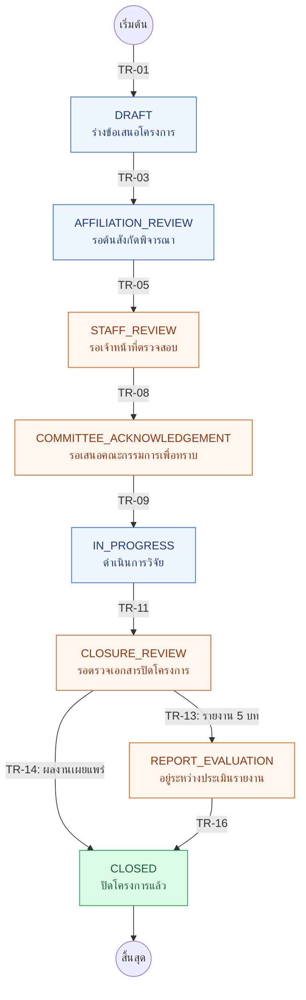

# State Transition Specification
## ระบบบริหารจัดการทุนวิจัยส่วนตัว มหาวิทยาลัยแม่ฟ้าหลวง

**Project:** Personal Research Grant Management System for Mae Fah Luang University  
**Team:** 404 Team Found  
**Version:** 1.5 — Revised to align with Requirements v1.5  
**วันที่:** 12 พฤศจิกายน 2569  
**สถานะ:** Draft — มีบางเงื่อนไขรอการยืนยันจาก Stakeholder  
**เอกสารอ้างอิง:** `requirements-v1.5-th-gap-reviewed.md`, To-Be Workflow, แบบฟอร์ม RS-1, ขั้นตอนทุนวิจัยส่วนตัว พ.ศ. 2570 และคำตอบ Stakeholder วันที่ 12 พฤศจิกายน 2569

## 1. วัตถุประสงค์และขอบเขต

กำหนด **สถานะหลักของโครงการวิจัย** การเปลี่ยนสถานะ ผู้ดำเนินการ และข้อจำกัด เพื่อใช้อ้างอิงร่วมกันใน Requirements, User Flow, Use Case, Backend และ Test Cases

- **สถานะหลัก** สื่อภาพรวมโครงการ ไม่ใช่ทุกขั้นตอนย่อยของงานเอกสาร
- **การแก้ไขเอกสาร การประเมินหนึ่งรอบ การขยายเวลา การแนบเอกสาร และการบันทึกทะเบียน** อาจเป็นเหตุการณ์ภายในสถานะเดิม
- **e-Office และการพิจารณาของต้นสังกัด/คณะกรรมการ** เป็นกระบวนการภายนอก Web ไม่มีการเชื่อมต่ออัตโนมัติใน Scope ปัจจุบัน
- ชุดสถานะ 8 สถานะและรหัส `TR-01`–`TR-16` คงตามเอกสารก่อนหน้า; รายละเอียดที่เปลี่ยนมีคำอธิบายในหัวข้อ 4–7

## 2. State Transition Diagram (Main Flow)

> แผนภาพนี้แสดงเฉพาะ **การเปลี่ยนสถานะหลัก** เพื่อให้อ่านบน GitHub ได้ง่าย ส่วนเหตุการณ์ที่ไม่เปลี่ยนสถานะ (`TR-02`, `04`, `06`, `10`, `12`, `15`) และเส้นทางที่ยังไม่ยืนยัน (`TR-07`) อยู่ในตารางหัวข้อ 4; **ไม่ใช่การลบ Transition เหล่านั้นออกจากข้อกำหนด**

**การอ่านแผนภาพ:** ตัวเลข `TR-xx` ตรงกับตารางในหัวข้อ 4; การเกิด `TR-16` หมายถึงเจ้าหน้าที่บันทึกปิดหลังรับรายงานฉบับแก้ไขและเอกสารที่กำหนด ไม่ใช่ปิดทันทีเมื่ออัปโหลด

## 3. State Definitions

| State ID | ชื่อสถานะ | ความหมายและผู้รับผิดชอบ |
|---|---|---|
| `DRAFT` | ร่างข้อเสนอโครงการ | นักวิจัยสร้าง/กรอก/นำเข้าและสกัด RS-1 ตรวจข้อมูลและบันทึกร่าง |
| `AFFILIATION_REVIEW` | รอต้นสังกัดพิจารณา | นักวิจัยจัดทำ RS-1 ฉบับพร้อมยื่นและนำไปดำเนินการกับต้นสังกัด **ภายนอก Web**; ไม่ยืนยันว่าต้นสังกัดได้รับเอกสารแล้ว |
| `STAFF_REVIEW` | รอเจ้าหน้าที่ตรวจสอบ | นักวิจัยส่งข้อเสนอผ่าน Web แล้ว; เจ้าหน้าที่ตรวจ RS-1 ฉบับลงนาม หลักฐานต้นสังกัด ข้อมูล/งบประมาณ และขอแก้ไขได้ |
| `COMMITTEE_ACKNOWLEDGEMENT` | รอเสนอคณะกรรมการเพื่อทราบ | เจ้าหน้าที่ตรวจผ่านและดำเนินเรื่องเสนอคณะกรรมการ **เพื่อทราบ** ไม่ใช่รออนุมัติผ่าน Web |
| `IN_PROGRESS` | ดำเนินการวิจัย | เจ้าหน้าที่บันทึกรับรองโครงการแล้ว; ติดตามเวลาและบันทึกผลคำขอขยายเวลาที่ดำเนินผ่าน e-Office |
| `CLOSURE_REVIEW` | รอตรวจเอกสารปิดโครงการ | นักวิจัยแนบ/ยื่นเอกสารปิดโครงการใน Web; เจ้าหน้าที่ตรวจตามเส้นทางที่เลือก ไม่เพิ่มระบบติดตามสถานะย่อยโดยพลการ |
| `REPORT_EVALUATION` | อยู่ระหว่างประเมินรายงาน | เฉพาะเส้นทางรายงาน 5 บท: ผู้ทรงคุณวุฒิประเมิน **หนึ่งรอบ** เจ้าหน้าที่จัดทำ PDF ผลประเมิน นักวิจัยส่งรายงานฉบับแก้ไข โดยไม่ส่งประเมินรอบสอง |
| `CLOSED` | ปิดโครงการแล้ว | เจ้าหน้าที่ตรวจเอกสารตามเงื่อนไขและบันทึกปิดใน Web; หนังสือแจ้งทางการดำเนินผ่าน e-Office |

## 4. Transition Rules

| ID | จาก | Trigger / เงื่อนไข | ผู้ดำเนินการ | ไป | สถานะข้อกำหนด |
|---|---|---|---|---|---|
| `TR-01` | เริ่มต้น | สร้างและบันทึกโครงการครั้งแรก | นักวิจัย | `DRAFT` | PROCESS/DESIGN |
| `TR-02` | `DRAFT` | กรอก อัปโหลด–สกัด ตรวจแก้ หรือบันทึกร่าง RS-1 | นักวิจัย | `DRAFT` | CONFIRMED เฉพาะแนวทาง Upload/Extract; วิธีทำงาน DESIGN |
| `TR-03` | `DRAFT` | ยืนยันจัดทำเอกสาร **ฉบับพร้อมยื่นต้นสังกัด**; Preview เฉย ๆ ไม่เปลี่ยนสถานะ | นักวิจัย | `AFFILIATION_REVIEW` | DESIGN; Trigger ยัง OPEN |
| `TR-04` | `AFFILIATION_REVIEW` | ปรับแก้ข้อเสนอ/จัดทำเอกสารฉบับใหม่หลังต้นสังกัดให้ความเห็น | นักวิจัย | `AFFILIATION_REVIEW` | PROCESS/DESIGN |
| `TR-05` | `AFFILIATION_REVIEW` | แนบ **RS-1 ที่ลงนามครบ** และหลักฐานต้นสังกัด (รายงานประชุม **หรือ** หนังสือยืนยัน); หากใช้ลายเซ็นอิเล็กทรอนิกส์ต้องได้รับความยินยอมเจ้าของลายเซ็น; กด **ยืนยันส่ง** ผ่าน Web | นักวิจัย | `STAFF_REVIEW` | หลักลงนาม/ความยินยอมอ้าง RS-1; วิธีตรวจรับผ่าน Web เป็น DESIGN |
| `TR-06` | `STAFF_REVIEW` | เจ้าหน้าที่แจ้งแก้ไขผ่าน Web; นักวิจัยแก้และยืนยันส่งใหม่ | เจ้าหน้าที่ / นักวิจัย | `STAFF_REVIEW` | PROCESS/DESIGN (งานย่อย) |
| `TR-07` | `STAFF_REVIEW` | กลับไปขอความเห็นชอบจากต้นสังกัดใหม่ **หาก** ลักษณะการแก้ไขเข้าเกณฑ์ที่ Stakeholder จะกำหนด | นักวิจัย | `AFFILIATION_REVIEW` | **OPEN — ยังไม่ใช้เป็นกฎบังคับ** |
| `TR-08` | `STAFF_REVIEW` | เจ้าหน้าที่ตรวจผ่านเอกสารและข้อเสนอ | เจ้าหน้าที่ | `COMMITTEE_ACKNOWLEDGEMENT` | PROCESS/DESIGN |
| `TR-09` | `COMMITTEE_ACKNOWLEDGEMENT` | หลังขั้นตอนเสนอ **เพื่อทราบ** เจ้าหน้าที่บันทึกรับรอง; กรณีมีมาตรฐานการวิจัยที่ต้องรับรอง ต้องตรวจเงื่อนไขที่เกี่ยวข้องตามนโยบาย | เจ้าหน้าที่ | `IN_PROGRESS` | PROCESS; **จะเตือนหรือบล็อกเมื่อขาดใบรับรองยัง OPEN** |
| `TR-10` | `IN_PROGRESS` | นักวิจัยยื่นคำขอขยายเวลา **ผ่าน e-Office**; เจ้าหน้าที่นำผลมาบันทึกใน Web; ไม่มีการยื่นคำขอขยายผ่าน Web | เจ้าหน้าที่ | `IN_PROGRESS` | **CONFIRMED** จาก Stakeholder |
| `TR-11` | `IN_PROGRESS` | นักวิจัยแนบเอกสารปิดโครงการใน Web และยืนยันส่งตามเส้นทางที่เลือก; ช่องทางทางการยังดำเนินแยก | นักวิจัย | `CLOSURE_REVIEW` | PROCESS/CONFIRMED เรื่องแนบเอกสาร |
| `TR-12` | `CLOSURE_REVIEW` | เจ้าหน้าที่พบเอกสารไม่ครบและขอเอกสารเพิ่ม; นักวิจัยแนบแก้ไข | เจ้าหน้าที่ / นักวิจัย | `CLOSURE_REVIEW` | PROCESS/DESIGN (ไม่ใช่ระบบติดตามสถานะย่อย) |
| `TR-13` | `CLOSURE_REVIEW` | เส้นทาง **รายงานวิจัย 5 บท**: เจ้าหน้าที่ตรวจเอกสารและเริ่มส่งร่างให้ผู้ทรงฯ ประเมิน | เจ้าหน้าที่ | `REPORT_EVALUATION` | PROCESS |
| `TR-14` | `CLOSURE_REVIEW` | เส้นทาง **ผลงานเผยแพร่**: เจ้าหน้าที่ตรวจเอกสาร/หลักฐานครบและ **บันทึกปิด** โดยไม่ส่งผู้ทรงฯ | เจ้าหน้าที่ | `CLOSED` | PROCESS |
| `TR-15` | `REPORT_EVALUATION` | ผู้ทรงฯ ส่งผลประเมิน **หนึ่งรอบ**; เจ้าหน้าที่สร้าง PDF ผลประเมินเพื่อนำส่งนักวิจัย; นักวิจัยส่งรายงานฉบับแก้ไข **โดยไม่ประเมินซ้ำ** | ผู้ทรงฯ / เจ้าหน้าที่ / นักวิจัย | `REPORT_EVALUATION` | **CONFIRMED** เรื่องหนึ่งรอบและ PDF; ช่องทางส่ง PDF ยัง OPEN |
| `TR-16` | `REPORT_EVALUATION` | ได้รับรายงานฉบับแก้ไขและเอกสารที่กำหนดครบ; เจ้าหน้าที่บันทึกปิด (ไม่ส่งให้ผู้ทรงฯ ประเมินซ้ำ) | เจ้าหน้าที่ | `CLOSED` | **CONFIRMED** เรื่องไม่ประเมินซ้ำ; การตรวจเอกสาร/บันทึกปิดตาม Workflow |

## 5. Business Rules และเหตุการณ์ที่ **ไม่เพิ่มสถานะหลัก**

| รหัสอ้างอิง | กฎ/เหตุการณ์ | ผลต่อ State Transition |
|---|---|---|
| `FR-SIG-01`–`06`, `BR-11`–`12` | RS-1 ต้องมีลายเซ็นครบก่อนส่งส่วนบริหารงานวิจัย และใช้ลายเซ็นอิเล็กทรอนิกส์ได้เมื่อได้รับความยินยอมเจ้าของลายเซ็น | ตรวจประกอบ `TR-05`; ไม่เพิ่มสถานะ “รอลงนาม” โดยอัตโนมัติ |
| `BR-01`, `FR-REG-01` | รอบรับข้อเสนอ ก.พ./มิ.ย. และการตรวจวันยื่น | กำหนดว่าจะบังคับส่งเฉพาะช่วงที่เปิดรับหรือไม่ **OPEN**; ไม่สมมติว่าระบบปฏิเสธเอง |
| `BR-13`, `FR-STD-01`–`03` | การรับรองมาตรฐานการวิจัยที่เกี่ยวข้อง (เช่น มนุษย์ สัตว์ทดลอง ความปลอดภัยทางชีวภาพ) | ต้องนำไปตรวจตามเกณฑ์จริงก่อนเริ่มดำเนินงาน; ผลต่อ `TR-09` **OPEN**; ไม่บล็อกทุกโครงการ |
| `SC-01`, `FR-ADM-09` | การขยายเวลาผ่าน e-Office แล้วเจ้าหน้าที่บันทึกผล | อยู่ `IN_PROGRESS` (`TR-10`); ไม่สร้างสถานะรออนุมัติการขยายภายใน Web |
| `SC-02`–`04` | ประเมินหนึ่งรอบ สร้าง PDF ผลประเมิน และไม่ติดตามสถานะย่อยการปิด | อยู่ `REPORT_EVALUATION` ระหว่างงาน (`TR-15`), ปิดเมื่อเจ้าหน้าที่บันทึก (`TR-16`) |
| `SC-06` | หนังสือแจ้งเริ่มดำเนินการ/แจ้งให้นักวิจัยดำเนินการผ่าน e-Office | Web แสดง/บันทึกสถานะ ไม่เป็นระบบส่งหนังสือราชการ |
| `BR-14`, `FR-REG-02` | โครงการไม่ดำเนินการหรือไม่ส่งเอกสารในกำหนดตามข้อ 1.3.9 | **OPEN:** ยังไม่ใส่ลูกศรลบหรือปิดโครงการเอง และไม่ลบข้อมูลถาวรอัตโนมัติ |
| `BR-15`, `FR-REG-03` | ทะเบียนมีค่า “ยกเลิก/ลาออก” | **OPEN:** ยังไม่กำหนดเป็น State ID หรือปลายทางจนกว่าจะรู้ความหมายและผู้ดำเนินการ |
| `BR-16`, `FR-REG-04` | ทะเบียนมีผลประเมิน 4 ประเภท และขั้นตอนย่อย (1)–(6) | ต้องทำ Data Dictionary/Mapping ไม่ถือเป็นสถานะโครงการทั้ง 4+6 แบบโดยอัตโนมัติ |

**การส่งกลับแก้ไข** (`TR-06`, `TR-12`) อาจใช้ `action_required_by` หรือ `revision_required` เป็นข้อมูลประกอบ โดยต้องบันทึกเหตุผล ผู้ดำเนินการ เวลา และเอกสารฉบับที่เกี่ยวข้อง (ข้อเสนอทางเทคนิค ไม่ใช่นโยบายที่ยืนยันแล้ว)

## 6. ประเด็นที่ต้องยืนยันก่อน Implement

| Open ID จาก Requirements v1.5 | ประเด็น | กระทบ |
|---|---|---|
| `OPEN-04` | นิยามการยืนยัน PDF “ฉบับพร้อมยื่น” | `TR-03` |
| `OPEN-05` | ข้อแก้ไขระดับใดต้องให้ต้นสังกัดเห็นชอบซ้ำ | `TR-07` |
| `OPEN-07` | ชื่อ/ค่าแบบประเมินในทะเบียนและกรณีไม่ส่งรายงานฉบับแก้ไขตามกำหนด | `TR-15`, `TR-16` / ทะเบียน |
| `OPEN-15`–`16` | วิธีตรวจความยินยอม/ความครบลายเซ็นและชนิดไฟล์ RS-1 ฉบับลงนาม | `TR-05` |
| `OPEN-17` | หลักฐานมาตรฐานวิจัยและเกณฑ์เตือน/บล็อกการเริ่มโครงการ | `TR-09` |
| `OPEN-18` | การบังคับเปิดรับข้อเสนอเฉพาะช่วง | `TR-05` |
| `OPEN-19` | ความหมายของการลบจากฐานข้อมูลตามข้อ 1.3.9 และผู้มีอำนาจ | ทะเบียน / Transition พิเศษที่ยังไม่กำหนด |
| `OPEN-20` | “ยกเลิก/ลาออก” เป็นสถานะหรือเหตุการณ์ | State ID / Transition พิเศษที่ยังไม่กำหนด |
| `OPEN-21` | ชื่อค่าในทะเบียนสำหรับผลประเมิน 4 แบบและขั้นตอนย่อย (1)–(6) | Data Dictionary / Mapping |

> **ไม่ควรสรุปเพิ่มสถานะ `CANCELLED` หรือ `REMOVED` หรือสร้าง `TR-17` โดยพลการ** ก่อนตอบ `OPEN-19`–`20` และกำหนดผลต่อประวัติข้อมูลที่ต้องตรวจย้อนหลัง

## 7. Acceptance Criteria ตัวอย่างที่ผูกกับ Transition

| AC ID | Given / When / Then (ย่อ) |
|---|---|
| `AC-TR-05` | **Given** โครงการอยู่ `AFFILIATION_REVIEW`; **When** แนบ RS-1 ลงนามครบ + หลักฐานต้นสังกัด และยืนยันส่งผ่าน Web; **Then** สถานะเป็น `STAFF_REVIEW` และมีเวลาส่ง; หากเพียงอัปโหลดไฟล์สถานะไม่เปลี่ยน |
| `AC-TR-09` | **Given** เจ้าหน้าที่ตรวจข้อเสนอผ่านและดำเนินขั้นตอนเสนอเพื่อทราบแล้ว; **When** เจ้าหน้าที่บันทึกรับรอง; **Then** สถานะเป็น `IN_PROGRESS` และมีประวัติ; ข้อกำหนดมาตรฐานวิจัยใช้ตามเกณฑ์ที่ได้รับการยืนยันเท่านั้น |
| `AC-TR-10` | **Given** โครงการอยู่ `IN_PROGRESS`; **When** เจ้าหน้าที่บันทึกผลการขยายเวลาที่ผ่าน e-Office; **Then** ข้อมูลกำหนดเวลาถูกอัปเดตพร้อมประวัติ แต่สถานะหลักยังเป็น `IN_PROGRESS` |
| `AC-TR-14` | **Given** เอกสารปิดเส้นทางเผยแพร่ผ่านการตรวจ; **When** เจ้าหน้าที่บันทึกปิด; **Then** สถานะเป็น `CLOSED`; การแนบเอกสารอย่างเดียวไม่ปิด |
| `AC-TR-16` | **Given** ผู้ทรงฯ ประเมินหนึ่งรอบและนักวิจัยส่งรายงานฉบับแก้ไขพร้อมเอกสารครบ; **When** เจ้าหน้าที่บันทึกปิด; **Then** สถานะเป็น `CLOSED` โดยไม่มีการมอบหมายประเมินรอบสอง |

## 8. Change Log / ความเชื่อมโยงเอกสาร

| เวอร์ชัน | รายการเปลี่ยนแปลง |
|---|---|
| ก่อน v1.5 | 8 สถานะหลัก; `TR-01`–`TR-16`; ประเมินรอบเดียว; e-Office แยกจาก Web |
| **v1.5** | เปลี่ยนแผนภาพเป็น `flowchart TD` แบบเส้นทางหลัก; เพิ่ม RS-1 ลงนามและความยินยอมใน `TR-05`; เชื่อมมาตรฐานวิจัยกับ `TR-09` แบบรอยืนยัน; ยืนยันการขยายเวลา `TR-10` และประเมินหนึ่งรอบ `TR-15`–`16`; เพิ่มทะเบียนยกเลิก/ลาออก ไม่ส่งเอกสารตามกำหนด และข้อมูลผลประเมินเป็นประเด็นรอการยืนยัน |

**เอกสารที่ต้องปรับตามเมื่อมีคำตอบเพิ่มเติม:** `requirements-v1.5-th-gap-reviewed.md`, `researcher-flow.md`, `staff-flow.md`, `reviewer-flow.md`, `use-case-diagram.md`, `use-case-specification.md`, Test Cases และ Data Dictionary; ให้เปลี่ยนรหัส/เงื่อนไขที่เกี่ยวข้องให้ตรงกันใน Commit เดียวกัน
