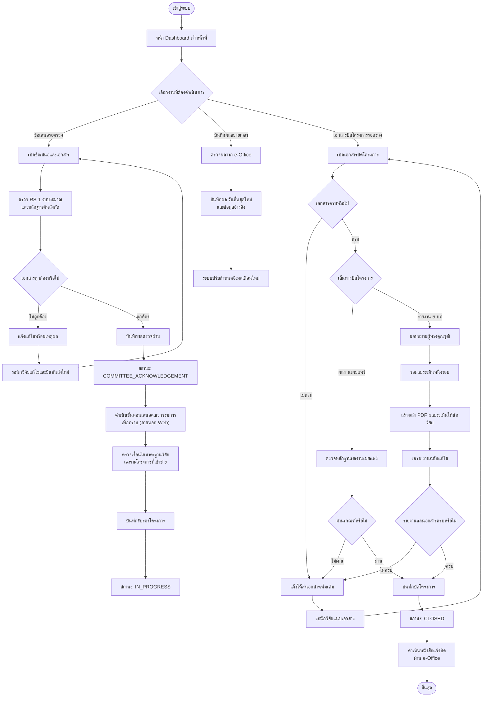
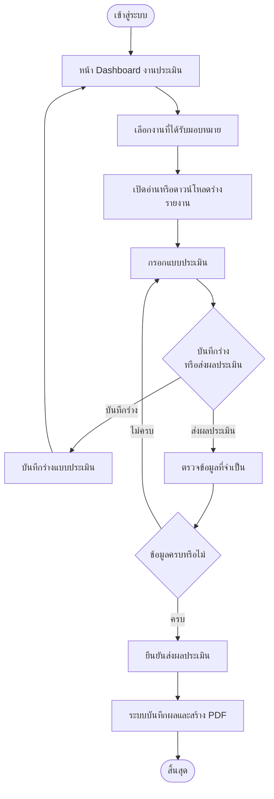

# User Flow

## ระบบบริหารจัดการทุนวิจัยส่วนตัว มหาวิทยาลัยแม่ฟ้าหลวง

เอกสารนี้แสดงลำดับการใช้งานของแต่ละบทบาทใน Web โดยอ้างอิง Workflow และ State Transition Diagram ล่าสุด

## 1. Researcher Flow

```mermaid
flowchart TD
    A([เข้าสู่ระบบ]) --> B["หน้าโครงการของฉัน"]
    B --> C{"สร้างโครงการใหม่<br/>หรือเปิดโครงการเดิม"}

    C -->|สร้างใหม่| D["สร้างโครงการ"]
    D --> E{"เลือกวิธีจัดทำ RS-1"}
    E -->|กรอกเอง| F["กรอก/แก้ไขข้อมูล RS-1"]
    E -->|อัปโหลด| G["อัปโหลด RS-1"]
    G --> H["ระบบสกัดข้อมูล"]
    H --> I["ตรวจสอบและแก้ไขข้อมูลที่สกัดได้"]
    F --> J["บันทึกร่าง"]
    I --> J
    C -->|เปิดโครงการเดิม| K["เปิดและแก้ไขร่าง"]
    K --> J

    J --> L["สถานะ: DRAFT"]
    L --> M{"ข้อมูลครบถ้วนหรือไม่"}
    M -->|ไม่ครบ| F
    M -->|ครบ| N["สร้าง PDF ฉบับพร้อมยื่น"]
    N --> O["สถานะ: AFFILIATION_REVIEW"]

    O --> P["นำเอกสารให้ต้นสังกัดพิจารณา<br/>(ภายนอก Web)"]
    P --> Q{"ต้นสังกัดเห็นชอบหรือไม่"}
    Q -->|ไม่เห็นชอบ| R["แก้ไขข้อเสนอและจัดทำ PDF ใหม่"]
    R --> O
    Q -->|เห็นชอบ| S["แนบ RS-1 ลงนาม<br/>และหลักฐานต้นสังกัด"]
    S --> T["ยืนยันความยินยอมลายเซ็น<br/>อิเล็กทรอนิกส์ หากมี"]
    T --> U["ยืนยันส่งข้อเสนอผ่าน Web"]
    U --> V["สถานะ: STAFF_REVIEW"]

    V --> W{"เจ้าหน้าที่ขอแก้ไขหรือไม่"}
    W -->|ขอแก้ไข| X["อ่านเหตุผล แก้ไข และยืนยันส่งใหม่"]
    X --> V
    W -->|ตรวจผ่าน| Y["สถานะ: COMMITTEE_ACKNOWLEDGEMENT<br/>รอเสนอคณะกรรมการเพื่อทราบ"]
    Y --> Z["ติดตามสถานะจนเป็น IN_PROGRESS"]

    Z --> AA["รับอีเมลเตือนใกล้ครบกำหนด"]
    AA --> AB{"ต้องขอขยายเวลาหรือไม่"}
    AB -->|ใช่| AC["ยื่นคำขอผ่าน e-Office"]
    AC --> AD["รอเจ้าหน้าที่บันทึกผลและวันสิ้นสุดใหม่"]
    AD --> Z
    AB -->|ไม่ใช่| AE{"ต้องเปลี่ยนแปลงข้อมูลโครงการหรือไม่"}
    AE -->|ใช่| AF["ยื่นคำขอผ่าน e-Office"]
    AF --> AG["รอเจ้าหน้าที่บันทึกผลและปรับปรุงข้อมูลที่อนุมัติ"]
    AG --> Z
    AE -->|ไม่ใช่| AH{"พร้อมปิดโครงการหรือไม่"}
    AH -->|ยังไม่พร้อม| Z
    AH -->|พร้อม| AI["เลือกเส้นทางปิดโครงการ"]

    AI -->|รายงาน 5 บท| AJ["แนบร่างรายงาน 5 บท"]
    AI -->|ผลงานเผยแพร่| AK["แนบรายงานย่อและหลักฐานผลงาน"]
    AJ --> AL["ยืนยันส่งเอกสารปิด"]
    AK --> AL
    AL --> AM["สถานะ: CLOSURE_REVIEW"]

    AM --> AN{"เจ้าหน้าที่ขอเอกสารเพิ่มหรือไม่"}
    AN -->|ใช่| AO["แนบเอกสารเพิ่มเติม"]
    AO --> AM
    AN -->|ไม่ต้องส่งเพิ่ม| AP{"เส้นทางปิดโครงการ"}
    AP -->|รายงาน 5 บท| AQ["สถานะ: REPORT_EVALUATION"]
    AQ --> AR["รับ PDF ผลประเมิน"]
    AR --> AS["แก้ไขและส่งรายงานฉบับสมบูรณ์"]
    AS --> AT["สถานะ: CLOSED"]
    AP -->|ผลงานเผยแพร่| AT
    AT --> AU([สิ้นสุด])
```

## 2. Staff Flow

## 3. Expert Reviewer Flow

## 4. หมายเหตุ

- การยื่นให้ต้นสังกัดพิจารณา การขยายเวลา และหนังสือแจ้งปิด เป็นกระบวนการที่ดำเนินผ่าน e-Office ภายนอก Web
- การส่งอีเมลเตือนใกล้ครบกำหนดไม่ทำให้สถานะโครงการเปลี่ยน
- เส้นทางรายงาน 5 บทให้ผู้ทรงคุณวุฒิประเมินเพียงหนึ่งรอบ และไม่มีการส่งประเมินซ้ำ
